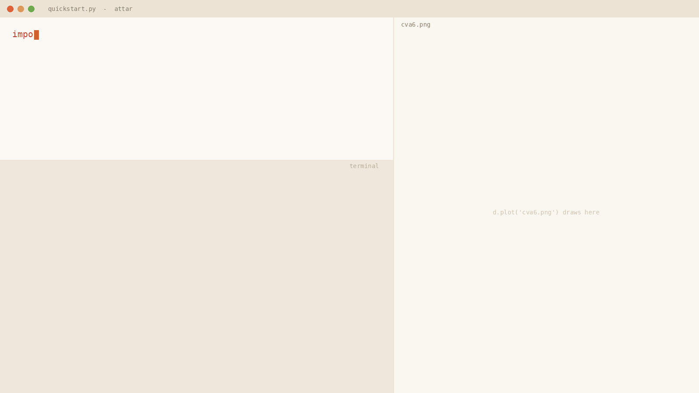
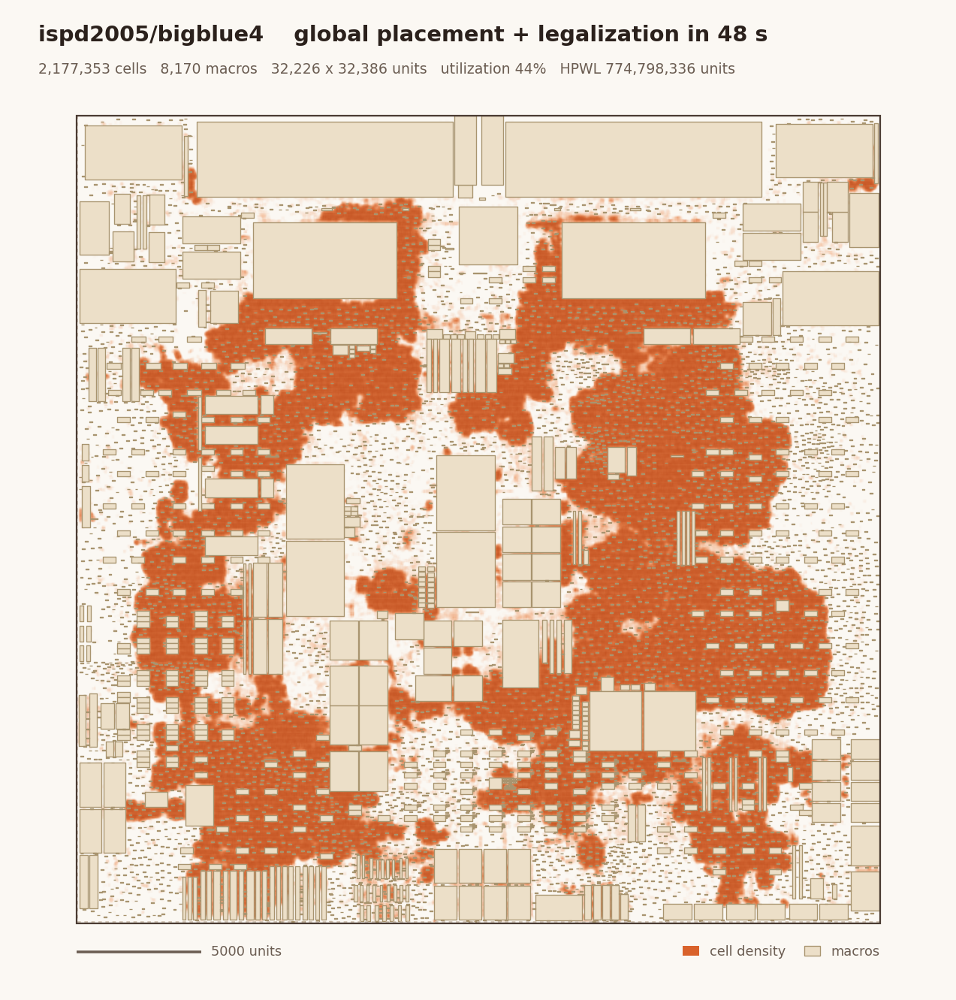
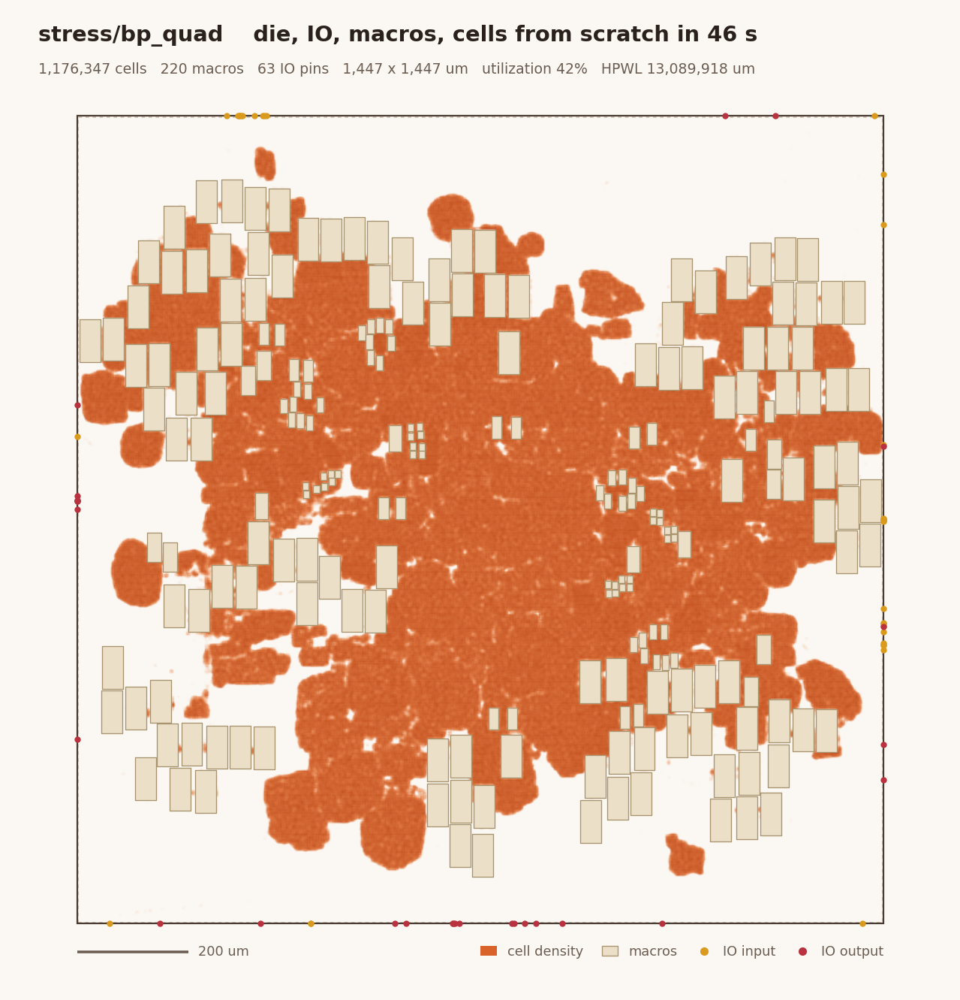
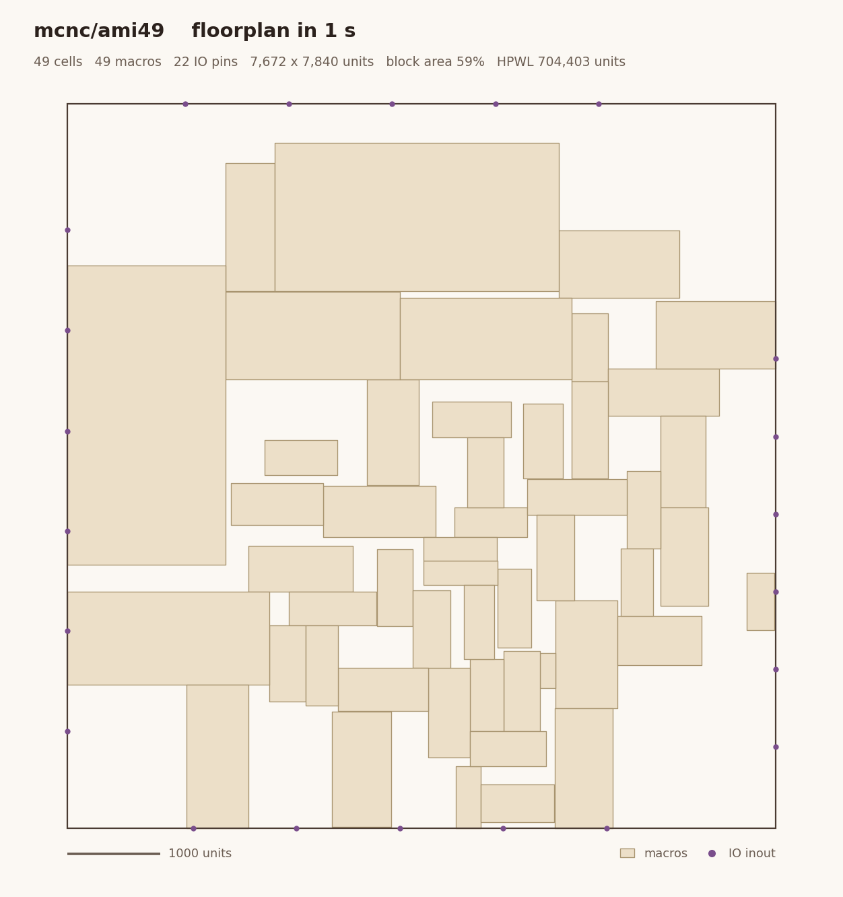

<div align="center">

# Attar

### The fast loop for physical design

Any placement benchmark as GPU tensors. Floorplan, place and evaluate a 100k-cell design in seconds,<br>
in a few lines of Python. Then hand the result to OpenROAD and route it.

[](pyproject.toml)
[](https://pytorch.org)
[](#does-the-fast-loop-agree-with-the-slow-loop)
[](tests)
[](LICENSE)

[Quickstart](#quickstart) &nbsp;·&nbsp; [How it works](#how-it-works) &nbsp;·&nbsp; [Gallery](#gallery) &nbsp;·&nbsp;
[Speed](#speed) &nbsp;·&nbsp; [Validation](#does-the-fast-loop-agree-with-the-slow-loop) &nbsp;·&nbsp;
[Benchmarks](#benchmarks) &nbsp;·&nbsp; [Roadmap](#roadmap)

<br>



<sub>A real run on an RTX 3080 Ti: cva6 from the ORFS floorplan stage, 108k cells and 8 SRAM macros.
IO pins, macros and a legal placement in about 4 seconds; handed to ORFS, this flow's floorplan routes with 0 DRC.</sub>

</div>

<br>

## Why a fast loop

Placement research lives in a loop: change an idea, place, look at the numbers, change again. The slow loop
(synthesis, place and route, signoff) takes minutes to hours per run. Attar is the other half: everything you need
to iterate on placement and floorplanning, **fast to run and fast to write**.

<table>
<tr>
<td width="25%" valign="top"><b>Fast to run</b><br><sub>The design lives on the GPU as flat tensors. HPWL of 8.9M pins in 3 ms; 2.2M cells placed and legalized in 48 s; a design loads in under a second.</sub></td>
<td width="25%" valign="top"><b>Fast to write</b><br><sub>One <code>Design</code>, one <code>Evaluator</code>, a basic set of engines (<code>attar.naive</code>). An algorithm is a function from tensors to positions: no database API, no TCL, no file formats.</sub></td>
<td width="25%" valign="top"><b>Honest about what it knows</b><br><sub>A design is a set of <i>facts</i> with provenance. What it can do follows from what it has, and nothing missing is ever made up.</sub></td>
<td width="25%" valign="top"><b>Checked against the slow loop</b><br><sub>HPWL equals OpenROAD's to 7 digits, legality equals <code>check_placement</code>, and the write-back round-trips through ORFS bit-identically.</sub></td>
</tr>
</table>

## Quickstart

```bash
git clone https://github.com/RayChang987/Attar.git attar && cd attar
pip install -e .                # torch (a CUDA build), numpy, matplotlib
```

```python
import attar

d = attar.load('orfs_asap7_2_1/cva6', device='cuda')
d.status()                # what it has, what it can do

d.floorplan()             # IO pins + macros   (or floorplan(utilization=0.6) for a new die)
d.place()                 # global placement + legalization
d.plot('cva6.png')
d.export('cva6.def')      # back to DEF, then on to ORFS
```

`examples/quickstart.py` is this program with a design name argument. The designs come from a local *zoo* that you
build from public benchmarks ([how](docs/benchmarks.md#building-the-zoo)); Attar ships the readers, not the data.

Your own algorithm takes the same few lines, because every engine is a function of the tensors:

```python
import torch, attar
from attar import naive

d = attar.load('ispd2005/adaptec1', device='cuda').restore('dreamplace_lg')
ev = attar.Evaluator(d)

pos = d.pos.clone().requires_grad_(True)              # (N, 2) lower-left corners
opt = torch.optim.Adam([pos], lr=0.5)
for _ in range(100):                                  # e.g. wirelength descent on the differentiable WA model
    opt.zero_grad(); d.wa_wirelength(pos, gamma=2.0).backward(); opt.step()   # 100 steps: 0.2 s

print(ev.hpwl(pos.detach()))                          # exact HPWL in milliseconds
print(ev.legality(pos.detach()))                      # rows, sites, overlaps, power rails: not legal any more
d.pos = pos.detach(); naive.legalize(d)               # ... so legalize (multi-row-height, rail aware)
```

## How it works

<p align="center"></p>

1. **Distill.** A reader turns a benchmark into the Attar IR: integer arrays in a safetensors file, plus a manifest
   that lists which facts the source provides and where each came from. Readers exist for LEF/DEF, Bookshelf, YAL
   and GSRC blocks.
2. **Load.** `attar.load` puts the arrays on the GPU as a `Design`. `d.status()` shows each fact, each capability,
   and what a hand-off to ORFS still needs.
3. **Move.** `attar.naive` is the basic, fully tensorized set of engines:
   - die sizing and IO pin placement
   - mixed-size macro placement, legalized on the grid that puts macro pins on their routing tracks
   - electrostatic global placement (ePlace/DREAMPlace style, Nesterov, CUDA graphs)
   - a multi-row-height, power-rail-aware legalizer

   Each answer becomes a fact that unlocks the next step.
4. **Measure.** `attar.Evaluator` computes HPWL (exact, batched), Steiner wirelength, RUDY, density overflow and
   legality, on the current placement or on any positions you pass.
5. **Hand off.** `d.export()` writes the answers into a copy of the source DEF. For ORFS designs,
   `tools/orfs_handoff.py` applies the floorplan to the ORFS run, and ORFS places, routes and times it.

More: [concepts](docs/concepts.md) · [benchmarks](docs/benchmarks.md) · [slow loop](docs/slow_loop.md) ·
[API](docs/api.md)

## Gallery

<table>
<tr>
<td width="50%"></td>
<td width="50%"></td>
</tr>
<tr>
<td><sub><b>ISPD 2005 bigblue4</b>: 2.18M cells, 8170 fixed macros. Global placement and legalization in 48 s.</sub></td>
<td><sub><b>bp_quad</b> (4x BlackParrot, 3nm-class NS3K): 1.18M cells, 220 macros. Die, IO pins, macros and cells
from scratch in 46 s, legal including power rails.</sub></td>
</tr>
<tr>
<td></td>
<td></td>
</tr>
<tr>
<td><sub><b>cva6</b> (ASAP7, ORFS floorplan stage): IO pins, 8 SRAMs and 108k cells in 4 s. ORFS routes it with 0 DRC.</sub></td>
<td><sub><b>MCNC ami49</b> (YAL): a block-level floorplan, 49 hard blocks, in 1 s.</sub></td>
</tr>
</table>

## Speed

RTX 3080 Ti (12 GB), PyTorch 2.4. Times include everything the call does.

| | cva6 (ASAP7) | bp_quad (NS3K) | bigblue4 (ISPD 05) |
| --- | ---: | ---: | ---: |
| cells / pins | 125k / 421k | 1.18M / 4.3M | 2.18M / 8.9M |
| load from disk to GPU | 0.36 s | 0.31 s | 0.99 s |
| HPWL, exact | **0.23 ms** | **1.5 ms** | **3.2 ms** |
| WA wirelength, forward + backward | 1.2 ms | 8.3 ms | 17 ms |
| floorplan (IO pins, macros) | 1.8 s | 21 s | |
| global placement + legalization | **2.0 s** | **27 s** | **48 s** |
| GPU memory, peak | 1.3 GB | 2.4 GB | 3.6 GB |

## Does the fast loop agree with the slow loop?

A fast loop is only useful if its numbers mean the same thing as the slow loop's. Four checks, each reproducible with
the tools in this repo:

| | check | result |
| --- | --- | --- |
| **1** | Attar's HPWL vs the HPWL OpenROAD computes from its own database, same DEF, 9 ASAP7 designs | equal to within **0.00002%** |
| **2** | Attar says legal, then OpenROAD `check_placement` on the written-back DEF; and 1% of the cells moved half a site | **9 / 9** legal on both; **9 / 9** broken rejected by both |
| **3** | ORFS's placement written back unchanged, then ORFS resize, DP, CTS, routing | routed WL, DRC, WNS, TNS **bit-identical** (gcd, aes, ibex, jpeg, ethmac) |
| **4** | HPWL vs routed wirelength, 951 routed runs of 16 designs (NS3K + Innovus) | same order at **≥ 2%** HPWL difference; a coin flip below 0.25% |

<p align="center"></p>

HPWL does *not* predict timing: WNS and TNS move independently of it. That is the next proxy to build ([roadmap](#roadmap)).

<details>
<summary><b>Check 1 in detail: HPWL against OpenROAD, design by design</b></summary>
<br>

`tools/validate_orfs.py`, ORFS's global placement of each design:

| design | cells | HPWL, Attar (um) | HPWL, OpenROAD (um) | difference |
| --- | ---: | ---: | ---: | ---: |
| gcd | 412 | 579.38 | 579.38 | -0.00001% |
| riscv32i | 10,106 | 42,491.95 | 42,491.94 | +0.00000% |
| aes | 12,420 | 40,690.80 | 40,690.80 | -0.00000% |
| ibex | 21,076 | 66,060.55 | 66,060.55 | -0.00001% |
| tinyRocket | 32,292 | 119,581.85 | 119,581.86 | -0.00000% |
| jpeg | 57,891 | 126,376.97 | 126,376.96 | +0.00001% |
| ethmac | 59,653 | 141,021.00 | 141,020.97 | +0.00002% |
| swerv_wrapper | 114,086 | 732,124.62 | 732,124.70 | -0.00001% |
| cva6 | 124,618 | 475,600.19 | 475,600.21 | -0.00001% |

The legality check covers rows, sites, overlaps, row segments cut around macros, and power-rail parity.
</details>

## Benchmarks

The zoo is built locally from public benchmarks by `tools/distill_benchmarks.py` and the ORFS tools. Each reader hands
over only the facts its format has. **155 designs in 17 suites; 116 go from their starting point to a legal result.**

<details open>
<summary><b>Suites</b></summary>
<br>

| suite | format | designs | starts from | status |
| --- | --- | ---: | --- | --- |
| ispd2005 | Bookshelf | 8 | cells unplaced | placed legally |
| ispd2015 | LEF/DEF | 20 | cells unplaced | placed legally (fence regions not enforced yet) |
| ispd2018, ispd2019 | LEF/DEF | 20 | placed | re-placed legally |
| ispd2024 | LEF/DEF (Nangate45) | 5 | placed | re-placed legally |
| iccad2025 | LEF/DEF (ASAP7) | 13 | placed | re-placed legally |
| gsrc_place | Bookshelf | 4 | cells unplaced | placed legally |
| ns3k | LEF/DEF (3nm-class) | 16 | cells unplaced | placed legally |
| orfs_asap7 | LEF/DEF from ORFS 3_3 | 9 | cells unplaced | placed legally, ORFS round trip |
| orfs_asap7_2_1 / _3_2 | LEF/DEF from ORFS 2_1 / 3_2 | 7 + 2 | IO pins, macros unplaced | floorplanned + placed legally, ORFS hand-off |
| stress/bp_quad | LEF/DEF (3nm-class) | 1 | placed | from scratch, legally |
| mcnc | YAL | 5 | blocks unplaced | floorplanned, no overlaps |
| gsrc_hard | GSRC blocks | 6 | no die | die sized, floorplanned, no overlaps |
| ispd2006_hb | Bookshelf | 28 | hard + soft blocks | runs; some block overlaps remain |
| gsrc_soft, mcnc_soft | GSRC blocks | 11 | soft blocks only | no geometry: nothing to place yet |

Details, data quirks and how to add a reader: [docs/benchmarks.md](docs/benchmarks.md).
</details>

## A design is a state

```text
>>> d = attar.load('orfs_asap7_2_1/aes'); d.status()
aes_cipher_top  (orfs/asap7, fidelity F1)
Problem facts
  ✅ netlist           def        11345 nets, 41039 pins
  ✅ cell_geometry     lef        11086 cells (11086 movable, 0 macros), 57 masters
  ✅ floorplan.die     def        1 die(s), 48.71 x 48.71 um
  ❌ floorplan.io      -          388 IO pins unplaced in the source
  ✅ rows              def        164 rows, height 0.27 um
  ...
Capabilities
  ✅ IO pin placement
  ❌ global placement                  needs floorplan.io
  ...
  -> missing floorplan.io: d.floorplan() places it; then d.export("out.def") and hand the floorplan to ORFS
```

Every reader states which facts it provides, and every engine and metric states which facts it needs:
- a Bookshelf design has no write-back;
- a block floorplan has no rows;
- a soft-block benchmark has no cell geometry.

Each can do exactly what its facts allow. Engines add facts with provenance (`floorplan.io: naive:place_io(nets)`), so
it is always clear which part of a design came from where. See [docs/concepts.md](docs/concepts.md).

## Roadmap

<p align="center"></p>

A proxy is lit once it is fast in Attar **and** shown to agree with the slow loop.

| | status | what is there | next |
| --- | --- | --- | --- |
| **HPWL evaluation** | done | exact on the GPU; equals OpenROAD; legality equals `check_placement` | |
| **Routed wirelength evaluation** | half way | ORFS hand-off and round trip; HPWL tracks routed WL above a 2% difference | a global-routing proxy, checked against ORFS routing |
| **Timing evaluation** | not yet | Liberty and SDC paths recorded with each design | a GPU timing proxy, checked against ORFS STA |

Also on the list:
- a legalizer that leaves an already-legal placement alone (today it re-spreads it: +12% HPWL on DREAMPlace's adaptec1 result);
- global placement that sees the gaps of rows cut around macros;
- fence regions and placement blockages (stored today only as counts);
- a block-level floorplanner for soft blocks (IBM-HB+, GSRC soft);
- 3D designs (per-die geometry) and a hosted zoo.

## Repository layout

```text
attar/            the package: Design, Evaluator, readers, kernels, attar.naive engines
examples/         quickstart.py, floorplan_flow.py
tools/            distillation, ORFS round trip and hand-off, validation, benchmarks, README figures
tests/            59 tests (python -m unittest discover -s tests); designs missing from the zoo are skipped
docs/             concepts, benchmarks, slow loop, API, the project spec (zh-TW), validation results, images
```

## Acknowledgements

Attar's global placement follows ePlace, DREAMPlace and Xplace; its rail checks follow OpenROAD's detailed placer.
The slow loop is [OpenROAD-flow-scripts](https://github.com/The-OpenROAD-Project/OpenROAD-flow-scripts) on the ASAP7
PDK. Benchmarks are from the ISPD, ICCAD and GSRC contests, MCNC and ORFS.

## License

[MIT](LICENSE)
