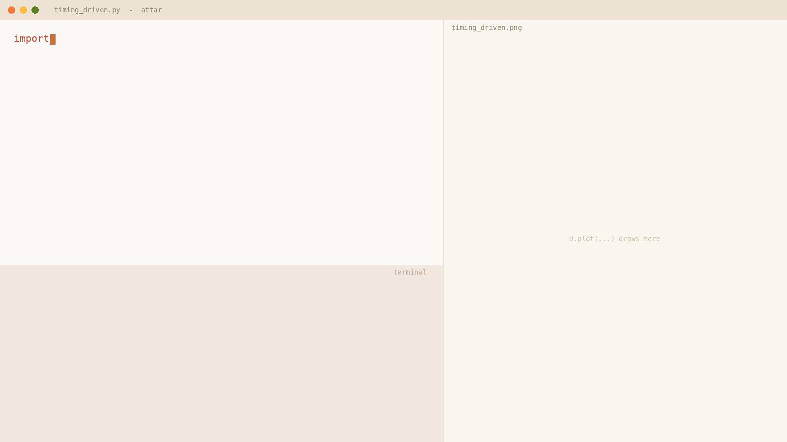
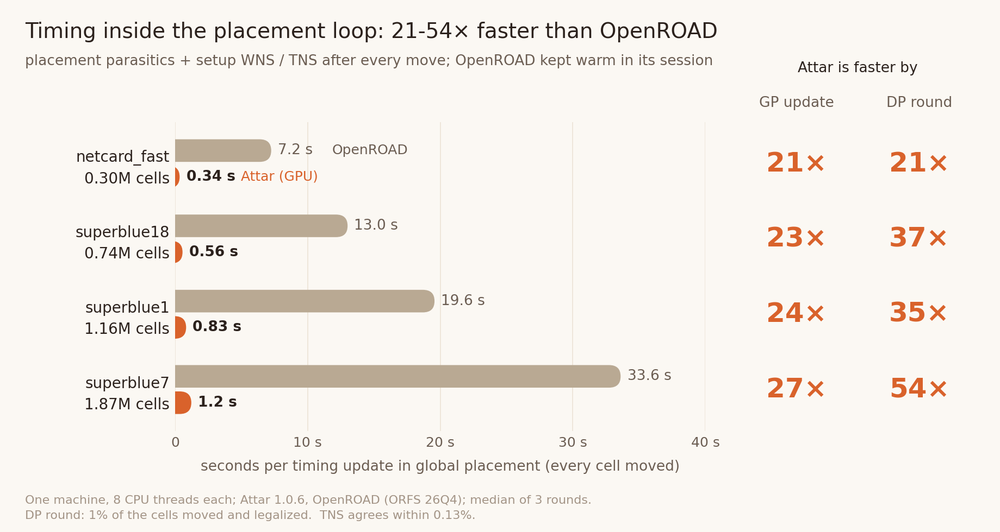
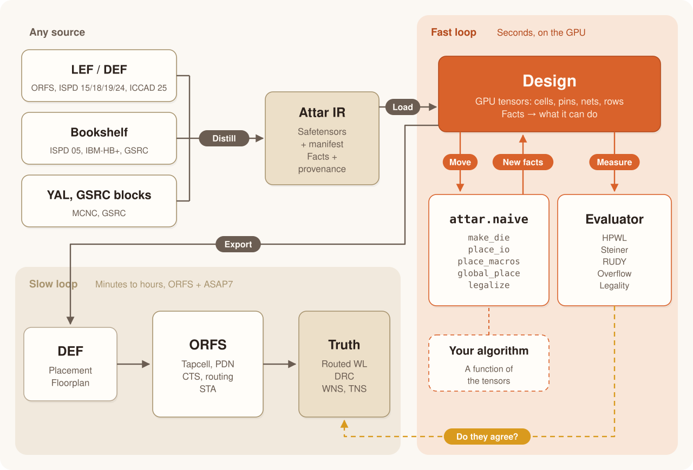
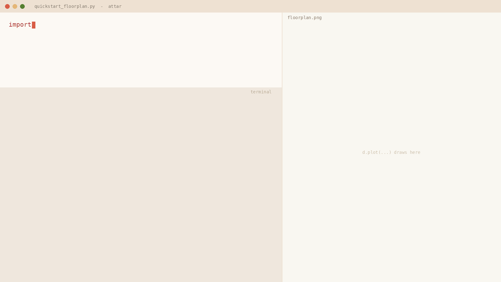
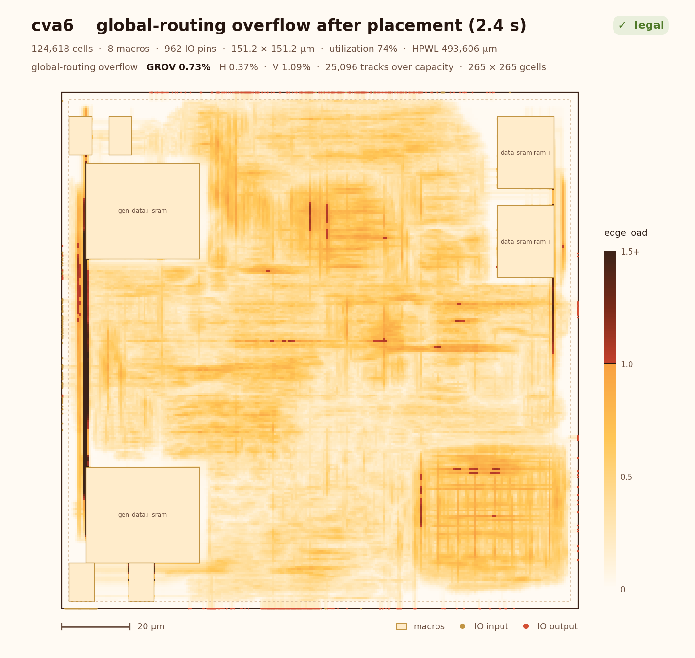
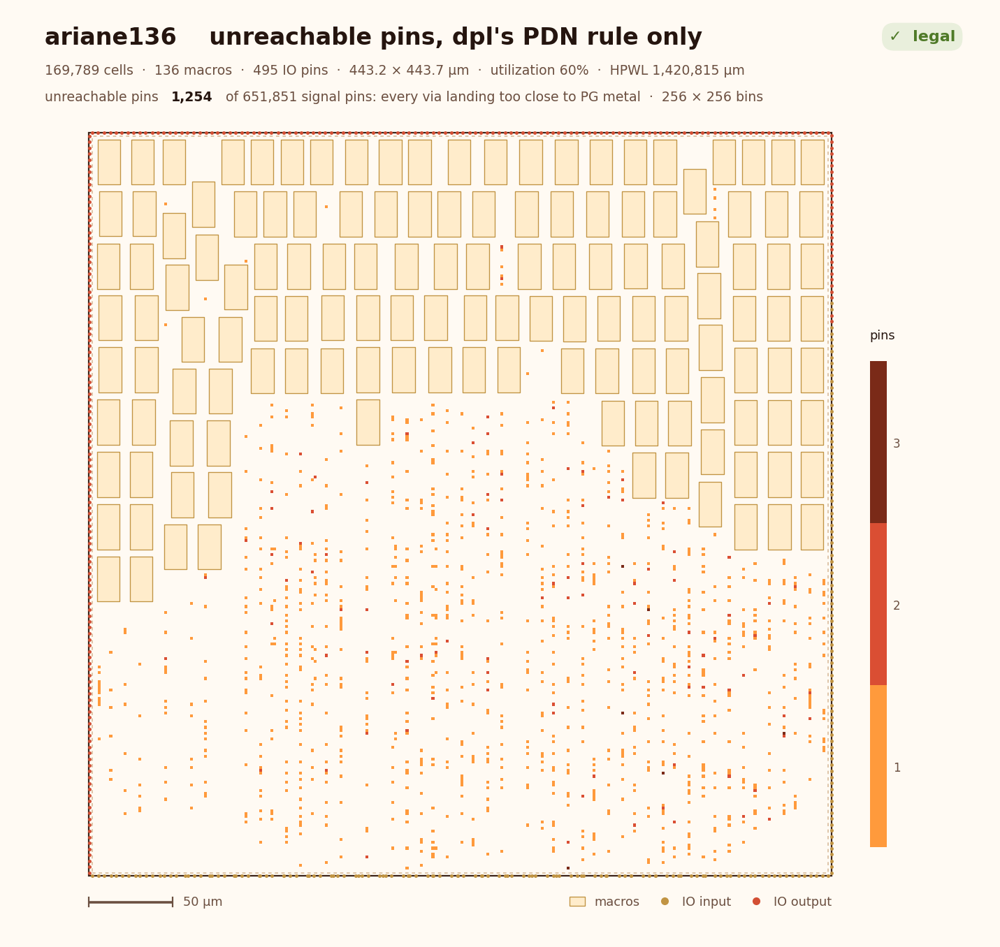
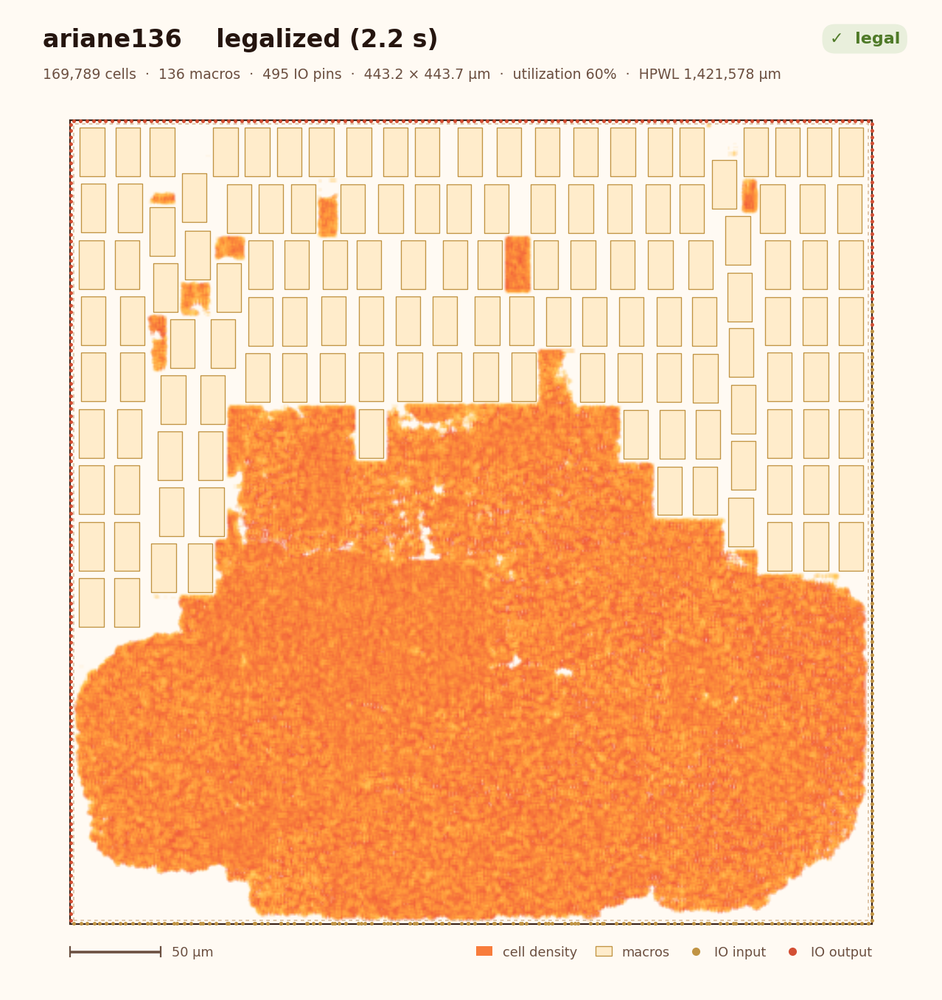
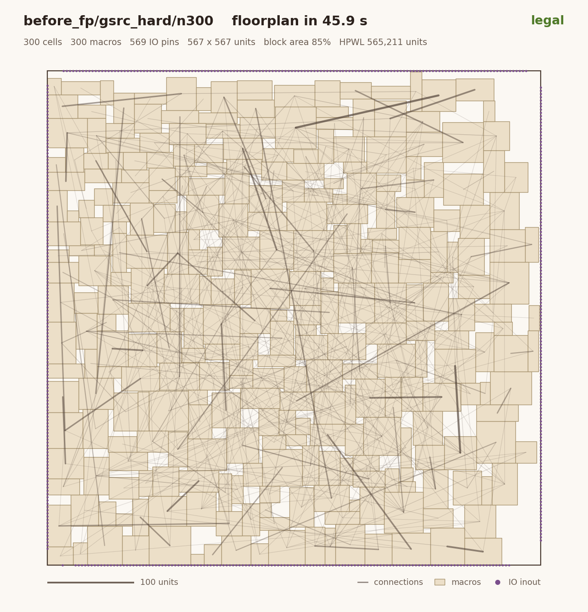

<div align="center">


Diverse P&R benchmarks, distilled into one plug-and-play PyTorch environment on the GPU.<br>
Evolve VLSI placement, timing-optimization and routing algorithms in minutes, not days.

[](https://github.com/RayChang987/Attar/blob/main/pyproject.toml)
[](https://pytorch.org)
[](https://pepy.tech/projects/attar)
[](https://github.com/RayChang987/Attar/blob/main/docs/features.md#evaluators)
[](https://github.com/RayChang987/Attar/tree/main/tests)
[](https://github.com/RayChang987/Attar/blob/main/LICENSE)

**English** &nbsp;·&nbsp; [繁體中文](README.zh-TW.md) &nbsp;·&nbsp; [简体中文](README.zh-CN.md)

[Quick start](#quick-start) &nbsp;·&nbsp; [Why Attar](#why-attar) &nbsp;·&nbsp; [What's inside](#whats-inside) &nbsp;·&nbsp;
[How it works](#how-it-works) &nbsp;·&nbsp; [Gallery](#gallery)

</div>

## Quick start

```bash
pip install attar
```

```python
import attar
d = attar.load('after_fp/orfs_asap7/aes', device='cuda')   # from the zoo, as tensors on the GPU
d.place()                                                   # or set d.pos from your own algorithm
print(attar.Evaluator(d).hpwl(), d.timing().wns)            # HPWL, and WNS as OpenSTA reports it
d.export('aes.def')                                         # back to OpenROAD, Innovus, ICC2, ...
```

Designs download from the [Attar zoo](https://huggingface.co/datasets/RayChang987/attar-zoo) on first use. The first
timing run on a GPU compiles its kernels (about two minutes, once per machine; in Colab, once per runtime unless
`TRITON_CACHE_DIR` and `TORCHINDUCTOR_CACHE_DIR` point to a folder that persists). No GPU? Everything also runs on the CPU, or try
the examples in Colab:

| notebook | what it runs |
| --- | --- |
| [](https://colab.research.google.com/github/RayChang987/Attar/blob/main/examples/colab/timing_driven_colab.ipynb) | Timing-driven placement in fifteen lines, the demo below: place cva6 for wirelength, time it, weight nets by slack as OpenROAD does, place again |
| [](https://colab.research.google.com/github/RayChang987/Attar/blob/main/examples/colab/latte_on_attar.ipynb) | **[DAC 2026]** LATTE, timing-driven detailed placement, step by step: a differentiable timer anchored on Attar's, independent sets, Adam with CAWP, judged after Attar's global routing, on an ICCAD 2025 contest design |
| [](https://colab.research.google.com/github/RayChang987/Attar/blob/main/examples/colab/p11_attar_superblue18.ipynb) | **[DAC 2026]** Hybrid net-pin weighting for timing-driven global placement, step by step: DATE 2025's pin pairs plus net weights derived from a delay model, built on Attar's timer and placer, on superblue18 (745k cells) |
| [](https://colab.research.google.com/github/RayChang987/Attar/blob/main/examples/colab/sroa_on_attar.ipynb) | **[ICCAD 2025]** SROA, GPU detailed placement for quality, step by step: every permutation of a few neighbouring cells, a DP over the rows, HPWL then MST wirelength, judged by Attar's global routing, on ispd19_test1 |
| [](https://colab.research.google.com/github/RayChang987/Attar/blob/main/examples/colab/date25_attar_superblue18.ipynb) | **[DATE 2025]** Pin-pair weighting for timing-driven global placement, step by step, on superblue18 |

<div align="center">


<sub>Timing-driven placement in 15 lines (<a href="examples/timing_driven.py">examples/timing_driven.py</a>):
cva6 WNS -195 → -75 ps, in 2.2 s.</sub>
</div>

## Why Attar

- **Fast.** Timing inside the placement loop 21-54x faster than OpenROAD kept warm; a 2.2M-cell design placed
  and legalized in 49 s. An idea, from your code or an AI agent's, is tested in seconds, not in an overnight
  P&R run.

<p align="center"></p>

<p align="center"><sub>Timing after every move, as a timing-driven placer needs it, against OpenROAD with the design already loaded: same machine, same rounds, TNS within 0.13%. <a href="https://github.com/RayChang987/Attar/blob/main/docs/validation/speed_vs_openroad.md">How it was measured</a>.</sub></p>

- **One environment.** 262 designs from 24 benchmark suites (ISPD 2005-2024, ICCAD 2015 and 2025, MCNC, GSRC,
  IBM-HB+, OpenROAD-flow-scripts) load with one call, in one format, from LEF/DEF, Bookshelf or YAL. An algorithm
  is a function from tensors to positions: no database API, no TCL.
- **Faithful.** Against OpenROAD and OpenSTA on the same placement: HPWL within 0.00002%, timing (WNS) within
  0.34%, power within 0.06%, global-routing wirelength within 3.6%.

## What's inside

<p align="center"></p>

Every engine and evaluator, with its accuracy against OpenROAD and OpenSTA:
[docs/features.md](https://github.com/RayChang987/Attar/blob/main/docs/features.md).

## How it works

<p align="center"></p>

Attar splits physical design at the power grid, as production flows do:

- **`before_fp`**: given a netlist, find the die, IO pins and macros (`d.floorplan()`).
- **`after_fp`**: given a fixed floorplan with its PDN, place the cells, then size, buffer, route and time them
  (`d.place()`).

Every design states the facts it has and where each came from, and every engine says which facts it needs:

```text
>>> d.status()
  ✅ netlist           def             12268 nets, 42885 pins
  ✅ cell_geometry     lef             12420 cells (12009 movable, 0 macros), 56 masters
  ✅ pdn               def             1815 wire and 4785 via shapes on M1, M2, M3
  ...
  ❌ placement         12009 movable cells unplaced
  -> only a placement is missing: place the design, then d.export("out.def")
```

Docs: [concepts](https://github.com/RayChang987/Attar/blob/main/docs/concepts.md) ·
[engines and evaluators](https://github.com/RayChang987/Attar/blob/main/docs/features.md) ·
[benchmarks](https://github.com/RayChang987/Attar/blob/main/docs/benchmarks.md) ·
[API](https://github.com/RayChang987/Attar/blob/main/docs/api.md) ·
[validation](https://github.com/RayChang987/Attar/tree/main/docs/validation)

## Gallery

<table>
<tr>
<td colspan="2"></td>
</tr>
<tr>
<td colspan="2"><sub><b>Floorplanning</b> GSRC n100: B*-tree packing fits all 100 blocks into the core in 5.1 s.</sub></td>
</tr>
<tr>
<td width="50%"></td>
<td width="50%"></td>
</tr>
<tr>
<td><sub><b>Routing congestion</b> cva6, placed in 2.4 s.</sub></td>
<td><sub><b>Pin access</b> ariane136 legalized with OpenROAD dpl's PDN rule only: 1,254 pins the router cannot reach past the power grid (signal-to-PG DRVs after Innovus routing). Attar's legalizer leaves none.</sub></td>
</tr>
<tr>
<td></td>
<td></td>
</tr>
<tr>
<td><sub><b>Legal placement</b> ariane136, rails and PDN included, in 2.2 s.</sub></td>
<td><sub><b>Floorplan</b> GSRC n300: 300 blocks, 569 IO pins, packed in 43 s.</sub></td>
</tr>
</table>

## Acknowledgements

Attar's placer follows ePlace, [DREAMPlace](https://github.com/limbo018/DREAMPlace) and [Xplace](https://github.com/cuhk-eda/Xplace); its timer follows [OpenSTA](https://github.com/the-openroad-project/opensta) and its checks follow OpenROAD.
It is validated against [OpenROAD-flow-scripts](https://github.com/the-openroad-project/openroad-flow-scripts) on ASAP7 and Nangate45. Benchmarks are from the ISPD, ICCAD and GSRC contests, MCNC and ORFS.

## License

<div align="center">
<a href="LICENSE"></a>
<br><br>
<sub>Copyright &copy; 2026 RayChang987 &nbsp;·&nbsp; free to use, modify and distribute; see <a href="LICENSE">LICENSE</a></sub>
<br><br>

</div>
