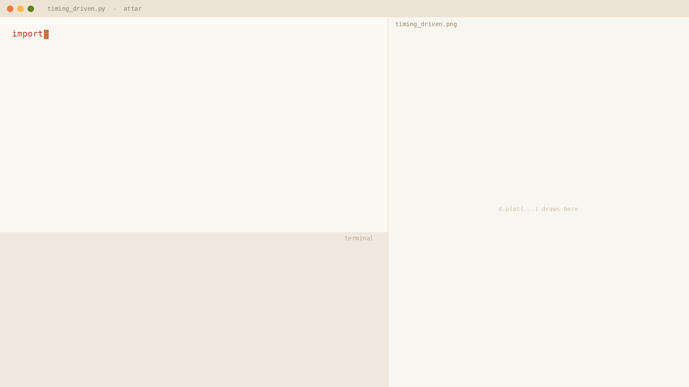
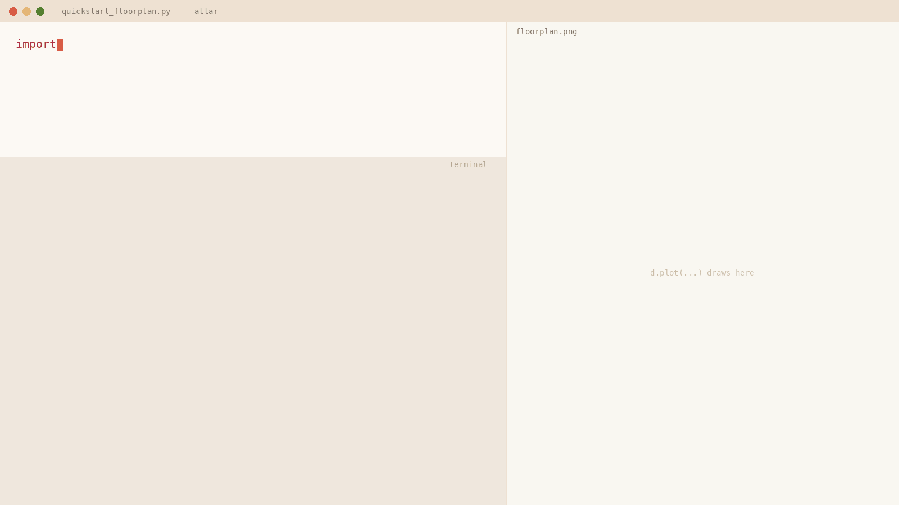
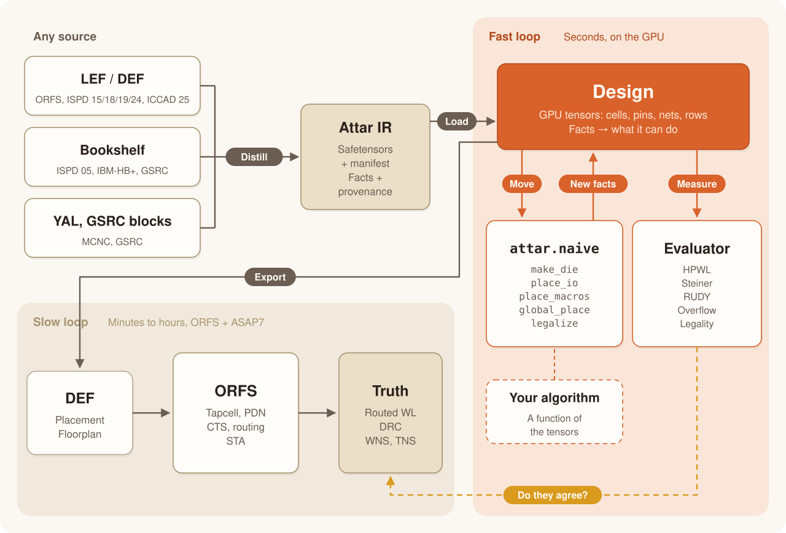
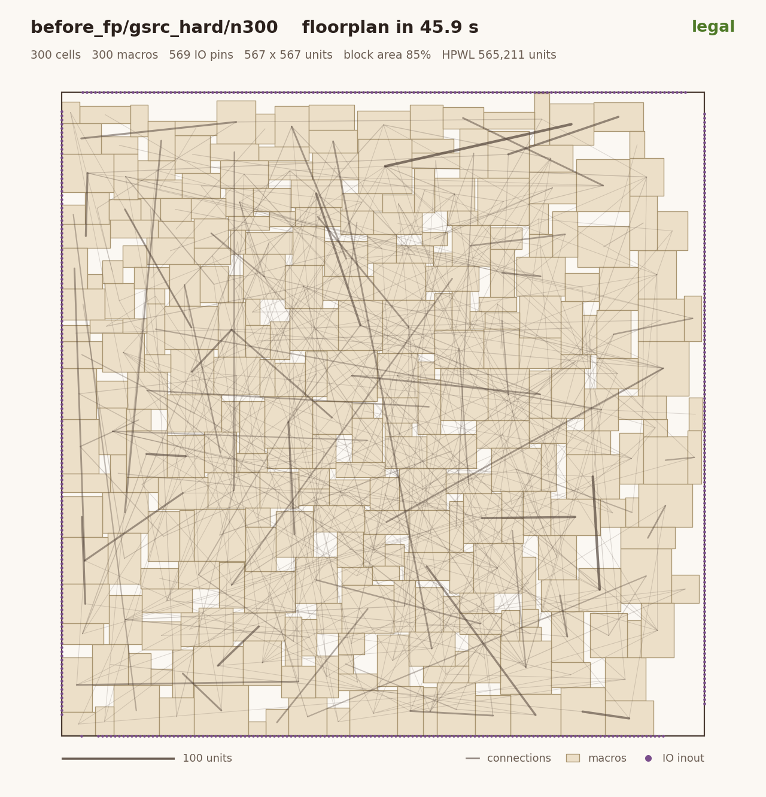
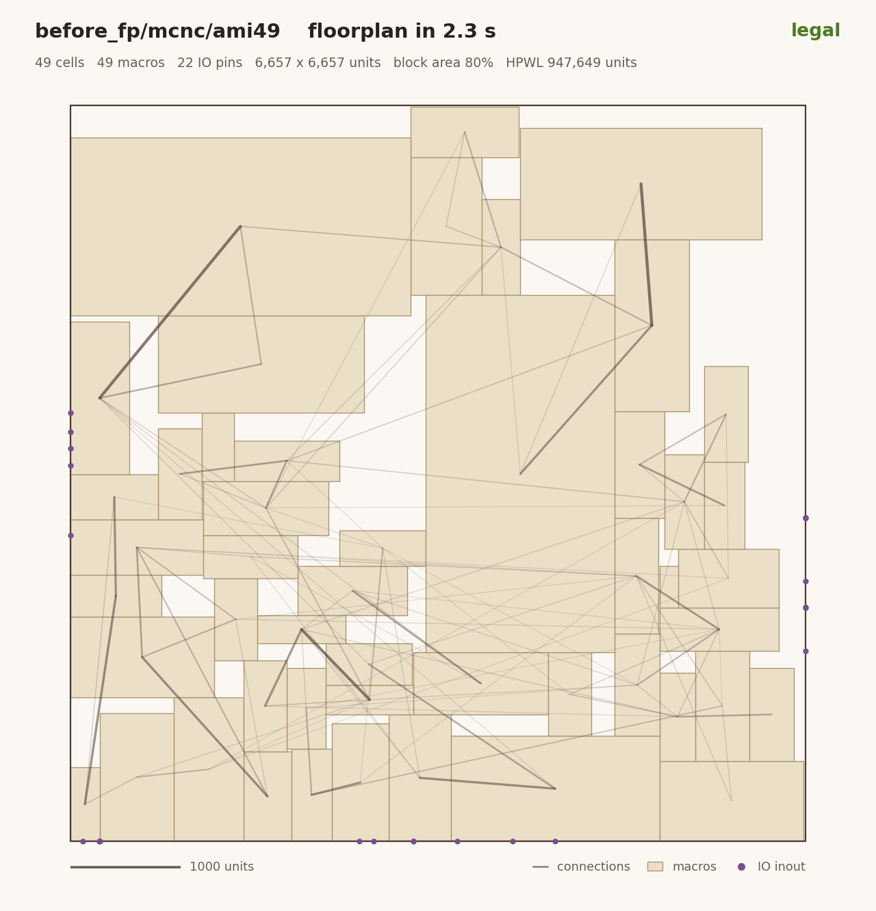
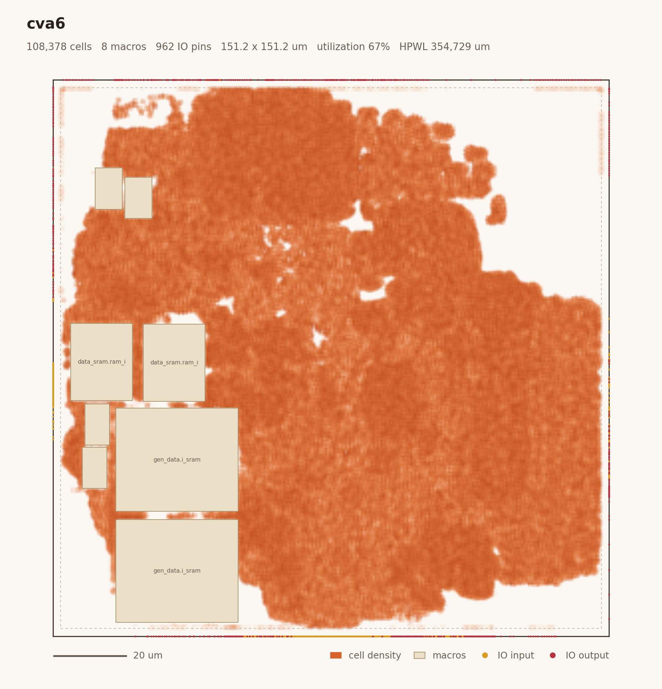
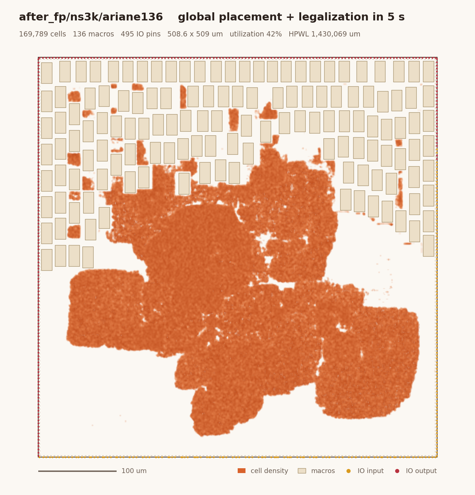
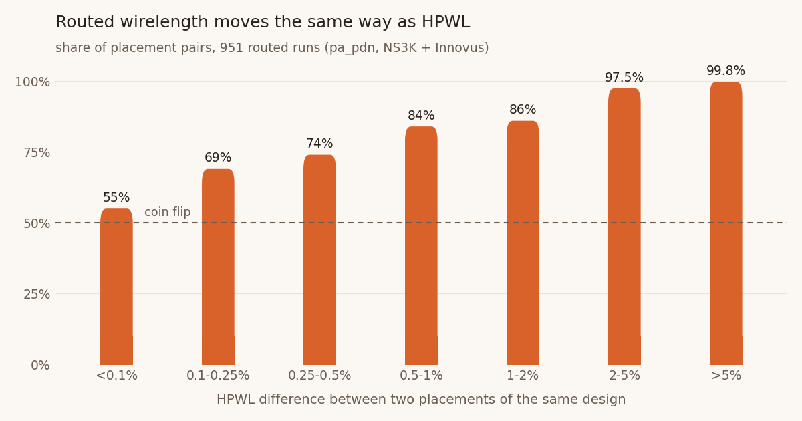
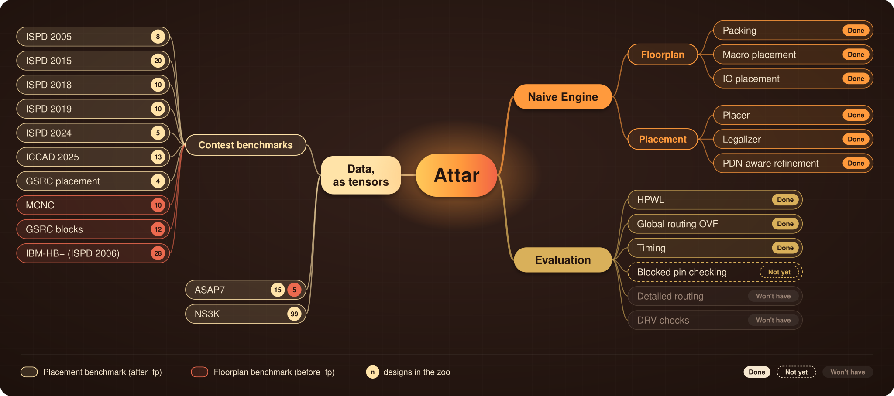

<div align="center">

# Attar

### The fast loop for physical design

Diverse P&R benchmarks, distilled into one plug-and-play PyTorch environment on the GPU.<br>
Place and evaluate a 100k-cell design in seconds, then hand it back to the full flow and route it.

[](pyproject.toml)
[](https://pytorch.org)
[](#does-the-fast-loop-agree-with-the-slow-loop)
[](tests)
[](LICENSE)

[Why Attar](#why-attar) &nbsp;·&nbsp; [Two modes](#two-modes) &nbsp;·&nbsp; [Built-in engines](#built-in-engines) &nbsp;·&nbsp;
[Quickstart](#quickstart) &nbsp;·&nbsp; [How it works](#how-it-works) &nbsp;·&nbsp; [Gallery](#gallery) &nbsp;·&nbsp;
[Validation](#does-the-fast-loop-agree-with-the-slow-loop) &nbsp;·&nbsp; [Roadmap](#roadmap)

<br>



<sub><b>Placement mode</b> (<code>after_fp</code>). Real runs on an RTX 3080 Ti, the same code on two designs. The
floorplan comes as the flow made it; only the cells are placed. <b>cva6</b> (ASAP7, ORFS global placement stage): 121k
cells around 8 SRAMs, legal in 2.5 s; handed back to ORFS it routes with 0 DRC and 7.4% less wire than ORFS's own
placement. <b>ariane133</b> (NS3K, Innovus floorplan at 80% std-cell density): 163k cells around 133 SRAMs, legal in
5.0 s.</sub>



<sub><b>Floorplan mode</b> (<code>before_fp</code>). GSRC <b>n100</b>: 100 hard blocks, no die; Attar sizes one for 85%
block area, places the IO pins and the macros. GP + LP legalization never overlaps macros, but here 5 stick out of
the core: not legal. <code>packing=True</code> (B*-tree, annealed into the core, then for HPWL) fits them all in
5.1 s, at 8% more wire. The lines are the strongest connections between macros and IO pins.</sub>

</div>

<br>

## Why Attar

1. **Speed decides quality.** When AI agents do the research, iteration speed is more than a metric: in our view it
   decides the quality of results (QoR). An agent that can propose, test and discard an idea in seconds finds what
   works. When every run takes hours, even the best algorithm starves for feedback.
2. **Data preparation is painful.** Traditional place-and-route (P&R) tools take minutes to hours per run, and every
   benchmark suite comes in its own format (LEF/DEF, Bookshelf, YAL, GSRC blocks) with its own gaps. Getting a design
   ready to experiment on is slow, fragmented work, repeated for every suite.
3. **Attar is the fast loop.** Attar distills diverse P&R benchmarks into one plug-and-play PyTorch environment:
   `attar.load` a name, and the design is on the GPU. Each reader hands over only the facts its source has, with
   their provenance, and nothing missing is made up ([a design is a state](#a-design-is-a-state)). The fast loop
   stays faithful to the full flows (the *slow loop*) without their overhead: its HPWL equals OpenROAD's to 7 digits,
   its legality equals `check_placement`, its placements route in OpenROAD-flow-scripts with 0 DRC, and HPWL ranks
   placements as routed wirelength does in 951 routed Innovus runs, once they differ by 2% or more
   ([validation](#does-the-fast-loop-agree-with-the-slow-loop)).
4. **GPU-native.** Layouts and design features are tensors on the GPU, so researchers, developers and AI agents
   train, evaluate and debug in the same few lines of Python: exact HPWL of 8.9M pins in 3 ms, a 2.2M-cell design
   placed and legalized in 49 s. An algorithm is a function from tensors to positions: no database
   API, no TCL, no file formats.

## Two modes

In production chip design, the power delivery network (PDN) is the dividing line: once the power grid and the macros
are locked down, the design enters a different phase. Attar splits its problems at that line. It does not synthesize
a PDN, and it should not: a `before_fp` answer goes to a flow that draws one (ORFS), and an `after_fp` problem comes
with the PDN its flow drew.

| | **Before-floorplan** (`before_fp`) | **After-floorplan** (`after_fp`) |
| --- | --- | --- |
| given | the netlist (an initial die for ORFS designs) | die, IO pins, macros, rows and PDN: a fixed floorplan |
| the answer | target utilization (the die), IO pin placement, macro placement | standard-cell placement; then timing optimization and global routing on the same floorplan |
| one call | `d.floorplan(utilization=0.6)` | `d.place()` |
| back to the slow loop | ORFS draws the PDN and places | ORFS or OpenROAD routes and times |
| in the zoo | 55 designs, 6 suites | 192 designs, 17 suites |

Today `after_fp` is about placement; Attar measures wirelength, congestion (RUDY), density and legality. Timing and
global-routing proxies are on the [roadmap](#roadmap).

## Built-in engines

Attar comes with a basic set of GPU engines, `attar.naive`, so a flow runs end to end even when you bring only one
part of it: to work on timing optimization, you need a placement, not a placer of your own. Every engine is fully
tensorized, states the facts it needs, and writes its answer back into the design with provenance
(`placement: naive`).

| engine | mode | call | what it does |
| --- | --- | --- | --- |
| **IO pin placer** | `before_fp` | `naive.place_io` | IO pins on the die boundary, net-aware once cells are placed |
| **Macro placer** | `before_fp` | `naive.place_macros` | mixed-size global placement, then macros legalized on their routing tracks with a halo; `packing=True` for block-level designs: B*-tree packing, annealed into the core, then for HPWL |
| **Global placer** | both | `naive.global_place` | electrostatic (ePlace/DREAMPlace style, Nesterov, CUDA graphs) at the slow loop's own target density; `routability=True`: DREAMPlace's cell inflation |
| **Legalizer** | `after_fp` | `naive.legalize` | multi-row-height cells, power-rail parity, signal pins clear of the PDN's via metal |
| **Placement refiner** | `after_fp` | not yet | detailed placement is next |

`d.floorplan(utilization=...)` sizes the die (`naive.make_die`), then places the IO pins and the macros;
`d.place()` is global placement plus legalization.

## Quickstart

```bash
git clone https://github.com/RayChang987/Attar.git attar && cd attar
pip install -e .                # torch (a CUDA build), numpy, matplotlib
```

```python
import attar

d = attar.load('after_fp/orfs_asap7/cva6', device='cuda')
d.status()                   # what it has, what it can do
d.plot('floorplan.png')      # die, macros, IO pins, PDN: given

d.place()                    # global placement + legalization
d.plot('placed.png')
d.export('placed.def')       # a DEF, back to the slow loop
```

`examples/quickstart_placement.py` is this program with a design name argument; `examples/quickstart_floorplan.py` is the same for
`before_fp` problems (`d.floorplan(utilization=0.6)` instead of `d.place()`, then `d.export` for ORFS). The designs come from the *zoo*, distilled from public
benchmarks and published on the Hugging Face Hub, where `attar.load` fetches a design on first use
([more](docs/benchmarks.md#building-the-zoo)); Attar ships the readers, the zoo the data.
`d.export` needs no raw file: the design keeps what it does not model of its source DEF (PDN, IO pin shapes, fixed
cells) and writes the cells and nets around it.

Your own algorithm takes the same few lines, because every engine is a function of the tensors:

```python
import torch, attar
from attar import naive

d = attar.load('after_fp/ispd2005/adaptec1', device='cuda').restore('dreamplace_lg')
ev = attar.Evaluator(d)

pos = d.pos.clone().requires_grad_(True)              # (N, 2) lower-left corners
opt = torch.optim.Adam([pos], lr=0.5)
for _ in range(100):                                  # e.g. wirelength descent on the differentiable WA model
    opt.zero_grad(); d.wa_wirelength(pos, gamma=2.0).backward(); opt.step()   # 100 steps: 0.2 s

print(ev.hpwl(pos.detach()))                          # exact HPWL in milliseconds
print(ev.legality(pos.detach()))                      # rows, sites, overlaps, power rails: not legal any more
d.pos = pos.detach(); naive.legalize(d)               # ... so legalize (multi-row-height, rail aware)
```

## How it works

<p align="center"></p>

1. **Distill.** A reader turns a benchmark into the Attar IR: integer arrays in a safetensors file, plus a manifest
   that lists which facts the source provides and where each came from. Readers exist for LEF/DEF, Bookshelf, YAL
   and GSRC blocks.
2. **Load.** `attar.load` puts the arrays on the GPU as a `Design`. `d.status()` shows each fact, each capability,
   and what a hand-off to ORFS still needs.
3. **Move.** Your algorithm, or the [built-in engines](#built-in-engines) (`attar.naive`), changes the positions:
   die, IO pins and macros for `before_fp`, cells for `after_fp`.
4. **Measure.** `attar.Evaluator` computes HPWL (exact, batched), Steiner wirelength, RUDY, density overflow and
   legality, on the current placement or on any positions you pass.
5. **Hand off.** `d.export(out_def)` writes the design back into its source DEF's frame: the PDN, IO pin shapes and
   fixed cells as they were, the cells and nets from the IR (a changed die, IO pins and macros included). For ORFS
   designs, `tools/orfs_roundtrip.py` takes a placement into the ORFS run, and ORFS routes and times it;
   `tools/orfs_handoff.py` takes a floorplan, and ORFS draws the PDN and goes on. Designs without an ORFS platform
   (i3dPDK_NS3K) go to OpenROAD with `tools/validate_openroad.py`.

More: [concepts](docs/concepts.md) · [benchmarks](docs/benchmarks.md) · [slow loop](docs/slow_loop.md) ·
[API](docs/api.md)

## Gallery

<table>
<tr>
<td width="50%"></td>
<td width="50%"></td>
</tr>
<tr>
<td><sub><b>GSRC n300</b> (floorplan mode): 300 hard blocks and 569 IO pins, no die given. Attar sizes one for 85% block
area and packs the blocks (B*-tree) in 46 s: legal, HPWL 565k.</sub></td>
<td><sub><b>MCNC ami49</b> (floorplan mode): 49 blocks of very different sizes in a die sized for 80% block area,
packed in 2.3 s: legal, HPWL 948k.</sub></td>
</tr>
<tr>
<td></td>
<td></td>
</tr>
<tr>
<td><sub><b>cva6</b> (ASAP7, ORFS global placement stage): 121k cells around 8 SRAMs in 2.5 s. ORFS routes it with
0 DRC and 7.4% less wire than its own placement.</sub></td>
<td><sub><b>ariane136</b> (NS3K, Innovus floorplan at 80% std-cell density): 170k cells around 136 SRAMs in 5.2 s,
legal including power rails and the PDN; OpenROAD's <code>check_placement</code> and global routing pass.</sub></td>
</tr>
</table>

## Does the fast loop agree with the slow loop?

A fast loop is only useful if its numbers mean the same thing as the slow loop's. Six checks, each reproducible with
the tools in this repo (ORFS on ASAP7 and Nangate45; OpenROAD alone on i3dPDK_NS3K, which has no ORFS platform):

| | check | result |
| --- | --- | --- |
| **1** | Attar's HPWL vs the HPWL OpenROAD computes from its own database, same DEF, 23 ORFS designs (15 ASAP7, 8 Nangate45) up to 1.05M cells | equal to within **0.00002%** |
| **2** | Attar says legal, then OpenROAD `check_placement` on Attar's DEF; and 1% of the cells moved half a site | ORFS **23 / 23**; NS3K at 60/70/80% density **62 / 84** (Attar legal on all 84): legal on both, broken rejected by both. On the other 22, all with macros, OpenROAD's `check_placement` crashes on the floorplan DEF itself ([which](docs/benchmarks.md#the-zoo-today)) |
| **3** | ORFS's own placement written back unchanged, then ORFS resize, DP, CTS, routing | routed WL, DRC, WNS, TNS **bit-identical**, **9 / 9** designs |
| **4** | Attar's own placement, at the design's target density, then ORFS to the end | **9 / 9** route with **0 DRC**; routed WL **0.2% to 7.4% shorter** than with ORFS's own placement |
| **5** | HPWL vs routed wirelength, 951 routed runs of 16 designs (NS3K + Innovus) | same order at **≥ 2%** HPWL difference; a coin flip below 0.25% |
| **6** | `before_fp`: Attar's floorplan (a new die at a looser or tighter utilization, IO pins, macros) handed to ORFS, which draws the PDN and places, up to detailed placement | **12 / 14** pass `check_placement` with no more slew / cap / fanout violations than ORFS's own floorplan, every macro and pin kept. The 2 that fail (tight cva6, tight swerv_wrapper: [why](docs/validation/fp_handoff.md)) are not in the zoo until the floorplan engines handle them<a id="before_fp-hand-off"></a> |

<p align="center"></p>

HPWL does *not* predict timing: WNS and TNS move independently of it, and Attar's placements are not timing-driven
(their WNS ranges from better to worse than ORFS's). Timing is the next proxy to build ([roadmap](#roadmap)).

<details>
<summary><b>Check 1 in detail: HPWL against OpenROAD, design by design</b></summary>
<br>

`tools/validate_orfs.py`, ORFS's global placement of each design:

| design | cells | HPWL, Attar (um) | HPWL, OpenROAD (um) | difference |
| --- | ---: | ---: | ---: | ---: |
| gcd | 412 | 579.38 | 579.38 | -0.00001% |
| riscv32i | 10,106 | 42,491.95 | 42,491.94 | +0.00000% |
| aes | 12,420 | 40,690.80 | 40,690.80 | -0.00000% |
| ibex | 21,076 | 66,060.55 | 66,060.55 | -0.00001% |
| tinyRocket | 32,292 | 119,581.85 | 119,581.86 | -0.00000% |
| jpeg | 57,891 | 126,376.97 | 126,376.96 | +0.00001% |
| ethmac | 59,653 | 141,021.00 | 141,020.97 | +0.00002% |
| swerv_wrapper | 114,086 | 732,124.62 | 732,124.70 | -0.00001% |
| cva6 | 124,618 | 475,600.19 | 475,600.21 | -0.00001% |
| jpeg_x20 | 1,052,787 | 5,979,077.00 | 5,979,076.93 | +0.00000% |

jpeg_x20 is 20 copies of the synthesized jpeg run through ORFS as one design: a million-cell scaling test.
The legality check covers rows, sites, overlaps, row segments cut around macros, power-rail parity, and signal pins
clear of the PDN's via metal (as OpenROAD's `check_placement` checks it).
All 23 ORFS designs, ASAP7 and Nangate45: [docs/validation/orfs_check.md](docs/validation/orfs_check.md).

</details>

<details>
<summary><b>Check 4 in detail: Attar's placement routed by ORFS</b></summary>
<br>

`tools/orfs_roundtrip.py <design> <run> def=<Attar's DEF>`: ORFS resizes, legalizes in detail, builds the clock tree,
routes and times Attar's placement. Target density: the one ORFS's own global placement used for the design.

| design | cells | target density | routed WL, ORFS's placement | routed WL, Attar's | difference | DRC | WNS, ORFS / Attar (ps) |
| --- | ---: | ---: | ---: | ---: | ---: | ---: | ---: |
| gcd | 412 | 0.75 | 812 | 792 | -2.5% | 0 | -37.7 / -35.4 |
| riscv32i | 10,106 | 0.749 | 55,422 | 53,144 | -4.1% | 0 | -16.1 / -48.9 |
| aes | 12,420 | 0.71 | 50,810 | 50,203 | -1.2% | 0 | -21.0 / -11.2 |
| ibex | 21,076 | 0.594 | 89,254 | 85,609 | -4.1% | 0 | -13.7 / -45.7 |
| tinyRocket | 32,292 | 0.506 | 157,727 | 151,074 | -4.2% | 0 | -90.1 / -100.3 |
| jpeg | 57,891 | 0.75 | 168,997 | 167,280 | -1.0% | 0 | -76.1 / -87.5 |
| ethmac | 59,653 | 0.79 | 196,952 | 196,594 | -0.2% | 0 | -75.9 / -80.2 |
| swerv_wrapper | 114,086 | 0.646 | 916,214 | 864,815 | -5.6% | 0 | -57.3 / -370.8 |
| cva6 | 124,618 | 0.84 | 642,595 | 595,183 | -7.4% | 0 | -57.1 / -32.2 |
Routed wirelength in um. tinyRocket runs with `LEC_CHECK=0`, as its ORFS baseline does: ORFS's equivalence checker
cannot read its generated memory macro. Attar's placements are not timing-driven; ORFS's are.
</details>

## A design is a state

```text
>>> d = attar.load('after_fp/orfs_asap7/aes'); d.status()
aes_cipher_top  (orfs/asap7, fidelity F1)
  placement target density 0.71 (orfs 3_3 global_place (GPL-0023))
Problem facts
  ✅ netlist           def        12268 nets, 42885 pins
  ✅ cell_geometry     lef        12420 cells (12009 movable, 0 macros), 56 masters
  ✅ floorplan.die     def        1 die(s), 48.71 x 48.71 um
  ✅ floorplan.io      def        388 IO pins placed
  ✅ rows              def        164 rows, height 0.27 um
  ✅ pdn               def        1815 wire and 4785 via shapes on M1, M2, M3
  ✅ def_frame         def        PDN, pins, fixed cells of the source DEF, kept verbatim (849 kB)
  ✅ slow_loop         orfs:asap7 ORFS aes, stage 3_3_place_gp
  ...
Solution state
  ❌ placement         12009 movable cells unplaced  (snapshots: reference)
  ...
  -> only a placement is missing: place the design (or restore a snapshot), then export and hand off
```

Every reader states which facts it provides, and every engine and metric states which facts it needs:
- a Bookshelf design has no cell library, so it does not export to DEF;
- a design with no special nets on the pin layers has no `pdn` rule to keep;
- a block floorplan has no rows;
- a soft-block benchmark has no cell geometry.

Each can do exactly what its facts allow. Engines add facts with provenance (`placement: naive`), so it is always
clear which part of a design came from where. See [docs/concepts.md](docs/concepts.md).

## Roadmap

<p align="center"></p>

A proxy is lit once it is fast in Attar **and** shown to agree with the slow loop.

| | status | what is there | next |
| --- | --- | --- | --- |
| **HPWL evaluation** | done | exact on the GPU; equals OpenROAD; legality equals `check_placement` | |
| **Routed wirelength evaluation** | half way | ORFS hand-off and round trip; HPWL tracks routed WL above a 2% difference | a global-routing proxy, checked against ORFS routing |
| **Timing evaluation** | not yet | Liberty and SDC paths recorded with each design | a GPU timing proxy, checked against ORFS STA |

## Acknowledgements

Attar's global placement follows ePlace, DREAMPlace and Xplace, and its routability option DREAMPlace's cell
inflation; its rail and PDN checks follow OpenROAD's detailed placer, and its PDN repair the row DP of pa_pdn.
The slow loop is [OpenROAD-flow-scripts](https://github.com/The-OpenROAD-Project/OpenROAD-flow-scripts) on the ASAP7
PDK. Benchmarks are from the ISPD, ICCAD and GSRC contests, MCNC and ORFS.

## License

[MIT](LICENSE)
