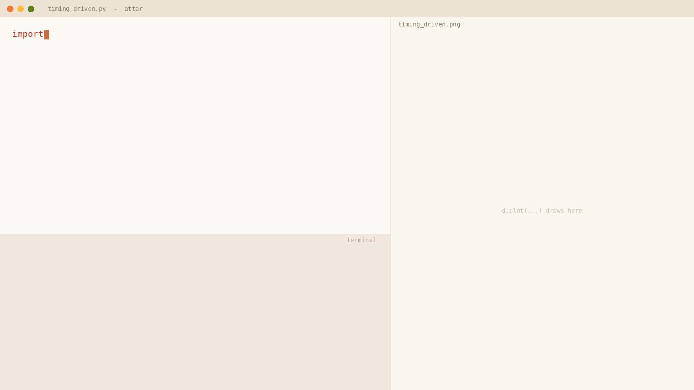
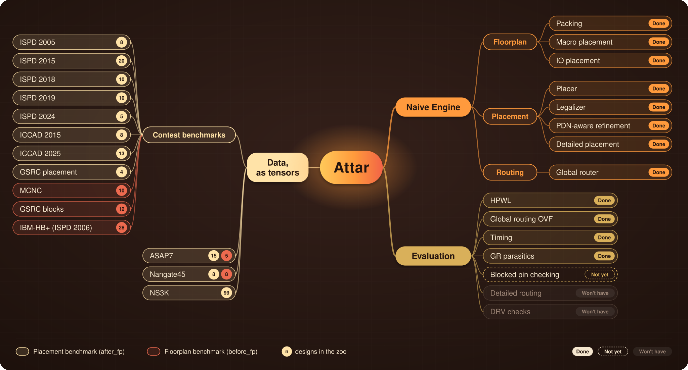
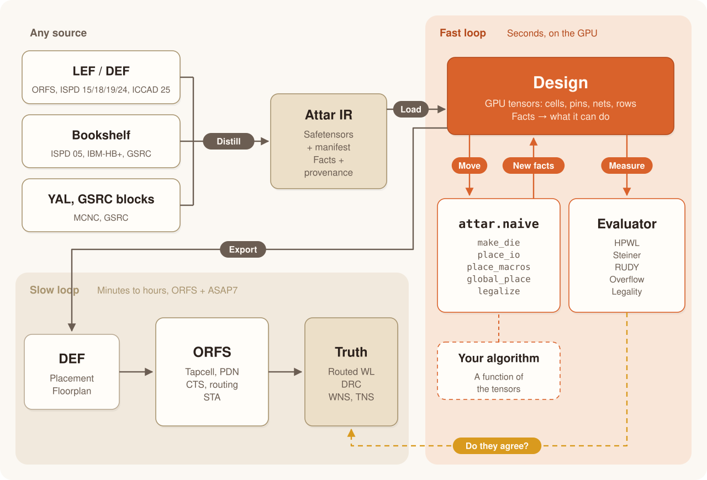
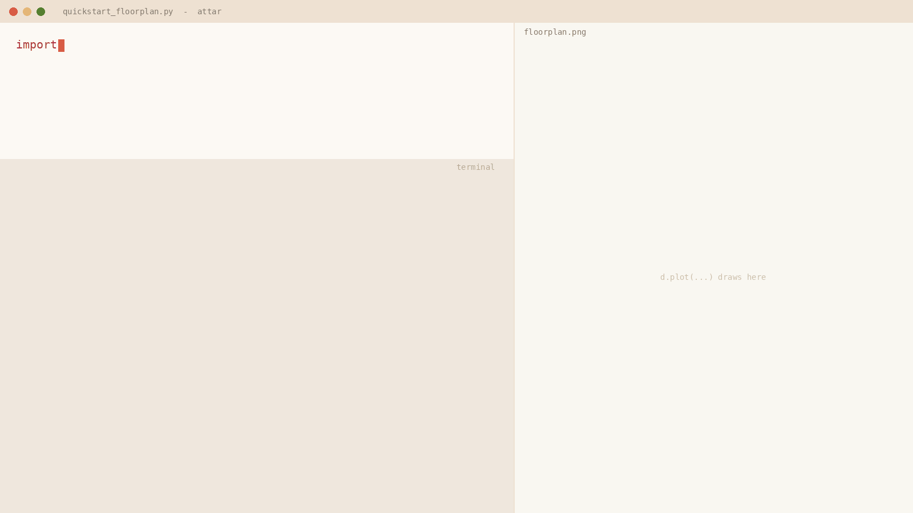
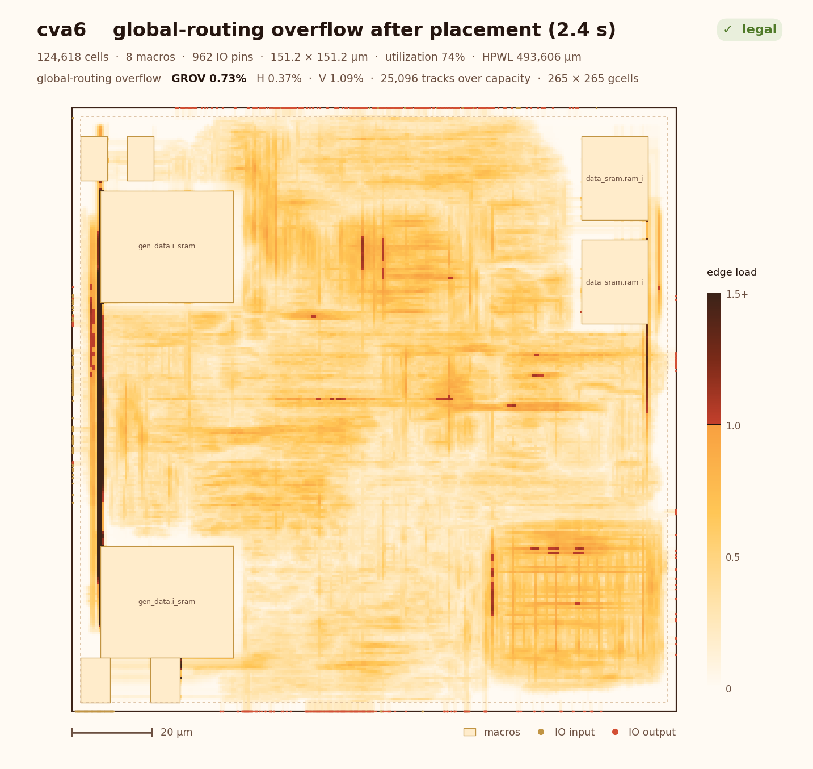
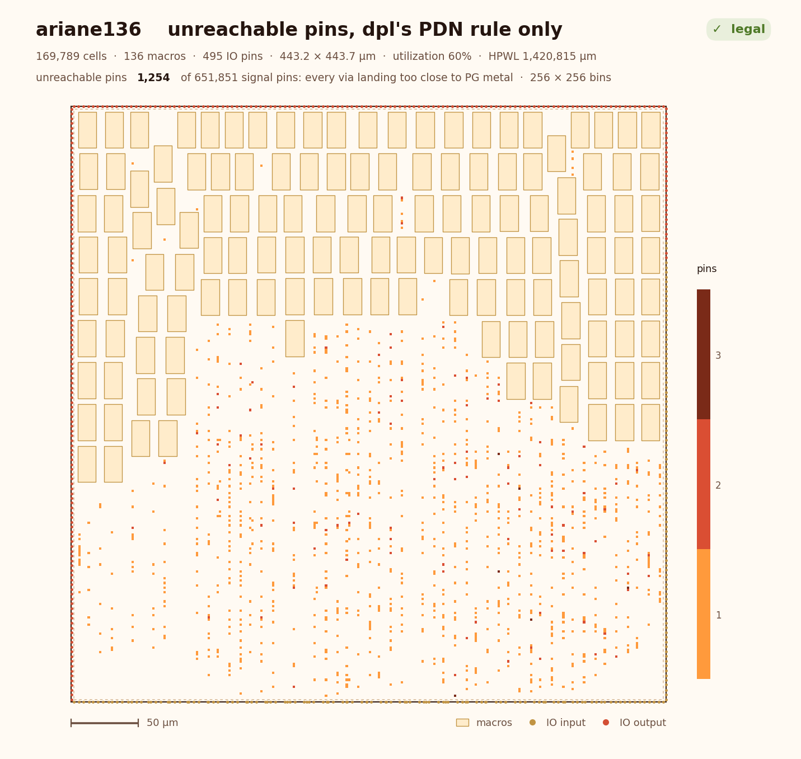
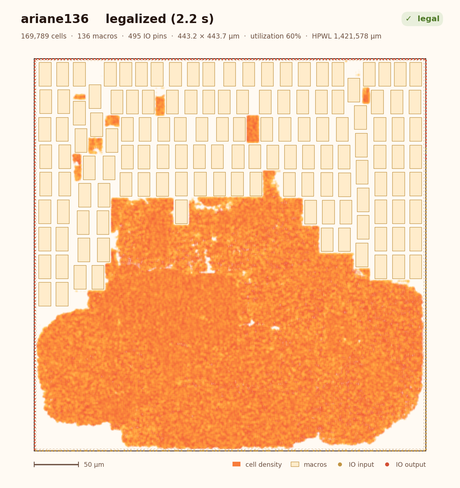
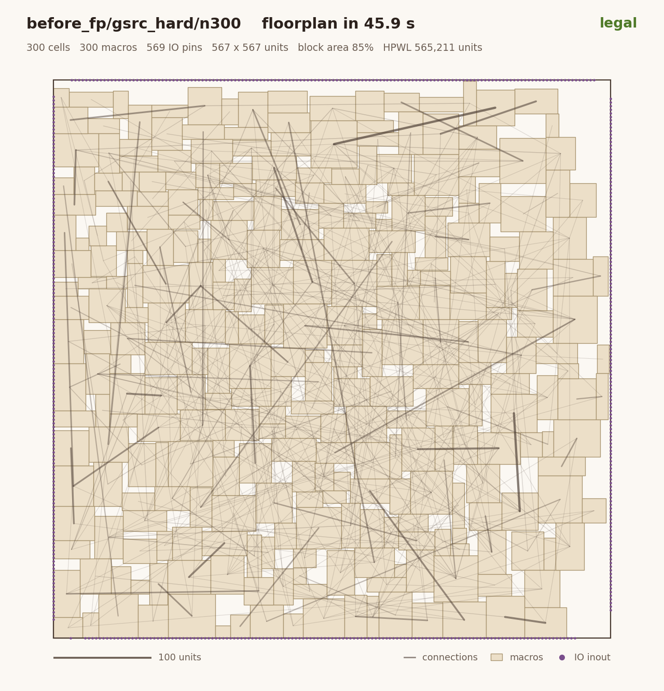

<div align="center">


将多样的 P&R 基准测试浓缩成一个即插即用、运行在 GPU 上的 PyTorch 环境。<br>
以分钟而非数天的时间，演进 VLSI 布局、时序优化与布线算法。

[](https://github.com/RayChang987/Attar/blob/main/pyproject.toml)
[](https://pytorch.org)
[](https://pepy.tech/projects/attar)
[](https://github.com/RayChang987/Attar/blob/main/docs/features.md#evaluators)
[](https://github.com/RayChang987/Attar/tree/main/tests)
[](https://github.com/RayChang987/Attar/blob/main/LICENSE)

[English](README.md) &nbsp;·&nbsp; [繁體中文](README.zh-TW.md) &nbsp;·&nbsp; **简体中文**

[快速开始](#快速开始) &nbsp;·&nbsp; [为什么选 Attar](#为什么选-attar) &nbsp;·&nbsp; [内容总览](#内容总览) &nbsp;·&nbsp;
[运行方式](#运行方式) &nbsp;·&nbsp; [图库](#图库)

</div>

## 快速开始

```bash
pip install attar
```

```python
import attar
d = attar.load('after_fp/orfs_asap7/aes', device='cuda')   # 从 zoo 载入，以张量形式放在 GPU 上
d.place()                                                   # 或用你自己的算法设置 d.pos
print(attar.Evaluator(d).hpwl(), d.timing().wns)            # HPWL，以及与 OpenSTA 一致的 WNS
d.export('aes.def')                                         # 导出回 OpenROAD、Innovus、ICC2 等
```

设计会在首次使用时从 [Attar zoo](https://huggingface.co/datasets/RayChang987/attar-zoo) 下载。GPU 上第一次运行时序分析会编译 kernel（约两分钟，每台机器一次；Colab 则是每个 runtime 一次，除非 `TRITON_CACHE_DIR` 与 `TORCHINDUCTOR_CACHE_DIR` 指向会保留的文件夹）。没有 GPU？所有功能也都能在 CPU 上运行，或在 Colab 试用以下示例：

| notebook | 内容 |
| --- | --- |
| [](https://colab.research.google.com/github/RayChang987/Attar/blob/main/examples/colab/timing_driven_colab.ipynb) | 十五行的时序驱动布局，即下方演示：先为线长布局 cva6、做时序分析、如 OpenROAD 按 slack 为 net 加权、再布局一次 |
| [](https://colab.research.google.com/github/RayChang987/Attar/blob/main/examples/colab/latte_on_attar.ipynb) | LATTE（DAC 2026）时序驱动 detailed placement，逐步拆解：锚定在 Attar timer 上的可微分 timer、独立集、Adam 加 CAWP，以 Attar global routing 后的时序评估，在 ICCAD 2025 竞赛设计上（英文） |
| [](https://colab.research.google.com/github/RayChang987/Attar/blob/main/examples/colab/p11_attar_superblue18.ipynb) | DAC 2026 的 net–pin 混合加权时序驱动 global placement，逐步拆解：DATE 2025 的 pin 对加上由延迟模型推导的 net 权重，建在 Attar 的 timer 与 placer 上，在 superblue18（74.5 万 cells）上运行（英文） |
| [](https://colab.research.google.com/github/RayChang987/Attar/blob/main/examples/colab/date25_attar_superblue18.ipynb) | DATE 2025 的 pin 对加权时序驱动 global placement，逐步拆解，在 superblue18 上运行（英文） |

<div align="center">


<sub>15 行代码完成时序驱动布局（<a href="examples/timing_driven.py">examples/timing_driven.py</a>）：
cva6 的 WNS 由 -195 ps 改善至 -75 ps，在 RTX 3080 Ti 上仅需 2.2 秒。</sub>
</div>

## 为什么选 Attar

- **快。** 890 万个 pin 的精确 HPWL 只要 3 ms；220 万 cell 的设计布局加合法化只要 49 秒。无论是你的代码或 AI agent 提出的点子，都能在数秒内验证，不必等一整夜的 P&R。
- **统一环境。** 来自 24 个基准测试套件（ISPD 2005-2024、ICCAD 2015 与 2025、MCNC、GSRC、IBM-HB+、OpenROAD-flow-scripts）的 262 个设计，一次调用、一种格式即可载入，支持 LEF/DEF、Bookshelf 或 YAL。算法就是“张量到位置”的函数：不需数据库 API，也不用 TCL。
- **忠实。** 在同一份布局上对比 OpenROAD 与 OpenSTA：HPWL 误差 0.00002% 以内、时序（WNS）0.34% 以内、功耗 0.06% 以内、全局布线线长 3.6% 以内。

## 内容总览

<p align="center"></p>

所有引擎与评估器，以及它们对比 OpenROAD 与 OpenSTA 的精确度：
[docs/features.md](https://github.com/RayChang987/Attar/blob/main/docs/features.md).

## 运行方式

<p align="center"></p>

Attar 如同量产流程，在电源网格（power grid）处将物理设计一分为二：

- **`before_fp`**：给定 netlist，决定芯片面积、IO pin 与宏单元（`d.floorplan()`）。
- **`after_fp`**：给定已固定的 floorplan 与 PDN，布局 cell，接着调整尺寸、插入缓冲器、布线并做时序分析（`d.place()`）。

每个设计都会说明它已有哪些信息及其来源，每个引擎也会说明它需要哪些信息：

```text
>>> d.status()
  ✅ netlist           def             12268 nets, 42885 pins
  ✅ cell_geometry     lef             12420 cells (12009 movable, 0 macros), 56 masters
  ✅ pdn               def             1815 wire and 4785 via shapes on M1, M2, M3
  ...
  ❌ placement         12009 movable cells unplaced
  -> 只缺布局：布局设计后执行 d.export("out.def")
```

文档：[概念](https://github.com/RayChang987/Attar/blob/main/docs/concepts.md) ·
[引擎与评估器](https://github.com/RayChang987/Attar/blob/main/docs/features.md) ·
[基准测试](https://github.com/RayChang987/Attar/blob/main/docs/benchmarks.md) ·
[API](https://github.com/RayChang987/Attar/blob/main/docs/api.md) ·
[validation](https://github.com/RayChang987/Attar/tree/main/docs/validation)

## 图库

<table>
<tr>
<td colspan="2"></td>
</tr>
<tr>
<td colspan="2"><sub><b>Floorplan</b> GSRC n100：B*-tree 封装在 5.1 秒内将 100 个区块全部放入核心。</sub></td>
</tr>
<tr>
<td width="50%"></td>
<td width="50%"></td>
</tr>
<tr>
<td><sub><b>布线拥塞</b> cva6，2.4 秒完成布局。</sub></td>
<td><sub><b>Pin access</b> ariane136：信号 pin 位于 PDN via 上的 cell。</sub></td>
</tr>
<tr>
<td></td>
<td></td>
</tr>
<tr>
<td><sub><b>合法布局</b> ariane136，含 rail 与 PDN，2.4 秒。</sub></td>
<td><sub><b>Floorplan</b> GSRC n300：300 个区块、569 个 IO pin，43 秒封装完成。</sub></td>
</tr>
</table>

## 致谢

Attar 的布局器遵循 ePlace、DREAMPlace 与 Xplace；检查则遵循 OpenROAD。它在 ASAP7 与 Nangate45 上对 [OpenROAD-flow-scripts](https://github.com/The-OpenROAD-Project/OpenROAD-flow-scripts) 做过验证。基准测试来自 ISPD、ICCAD、GSRC 竞赛、MCNC 与 ORFS。

## 授权

<div align="center">
<a href="LICENSE"></a>
<br><br>
<sub>Copyright &copy; 2026 RayChang987 &nbsp;·&nbsp; 可自由使用、修改与分发；详见 <a href="LICENSE">LICENSE</a></sub>
<br><br>

</div>
