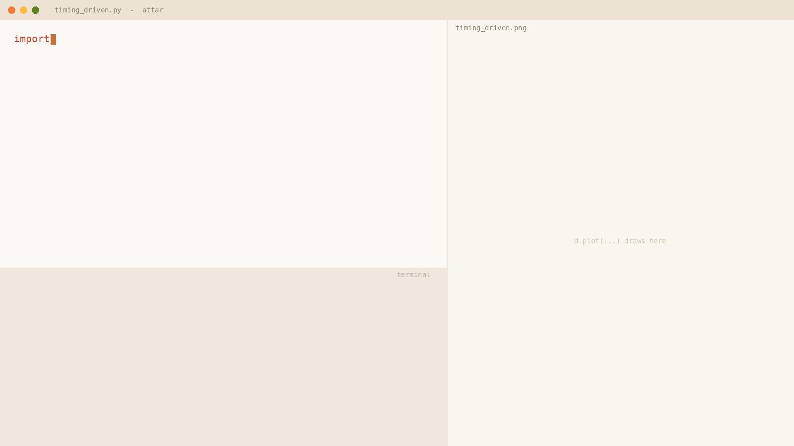
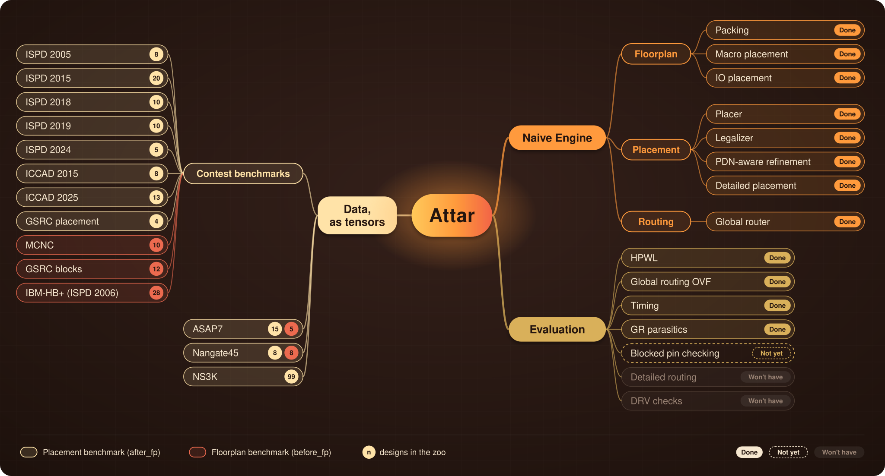
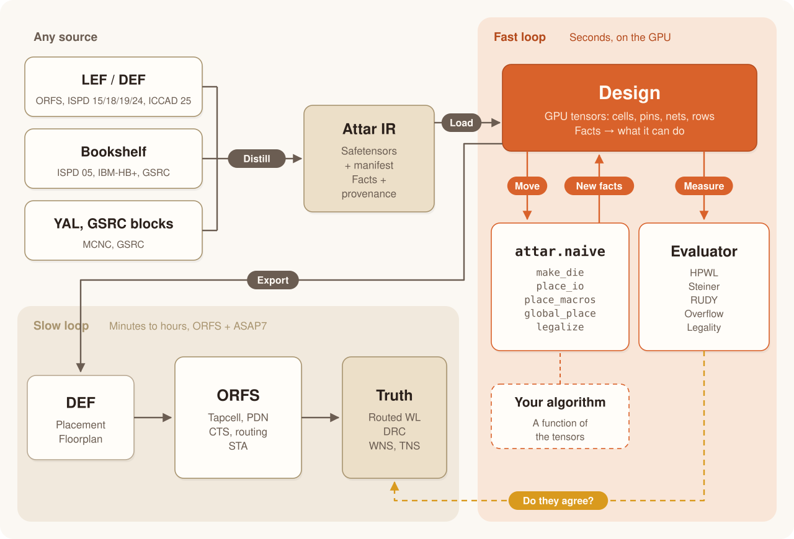
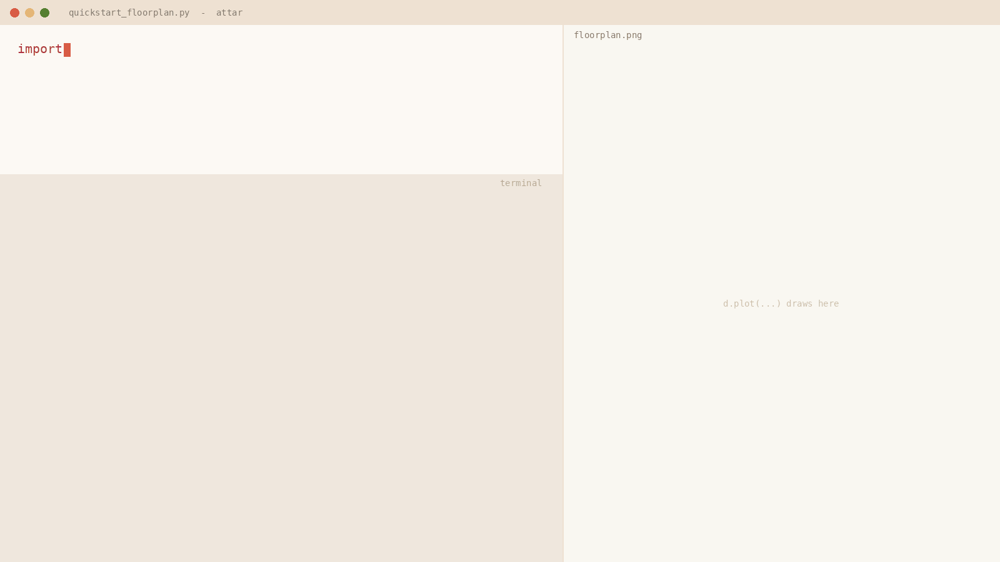
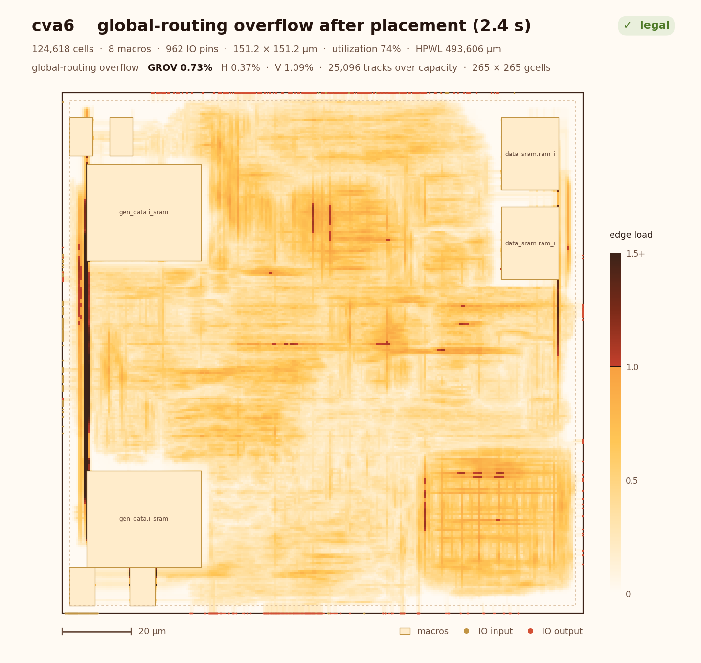
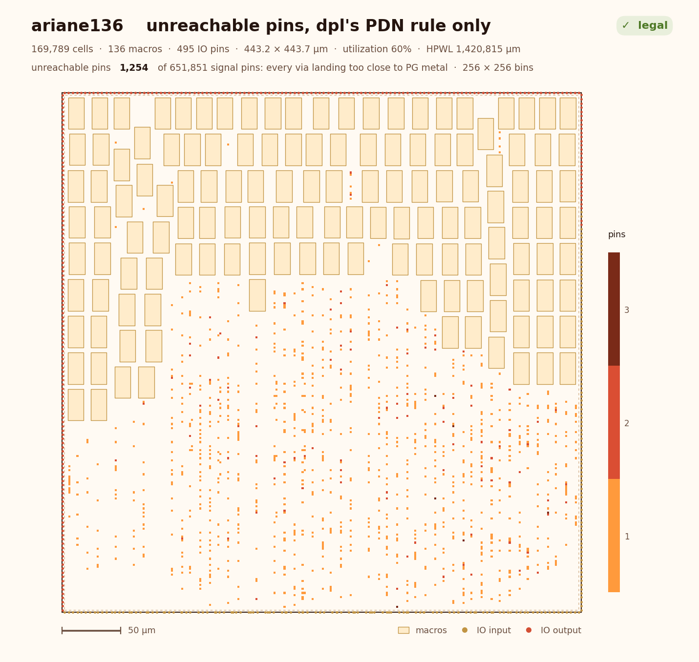
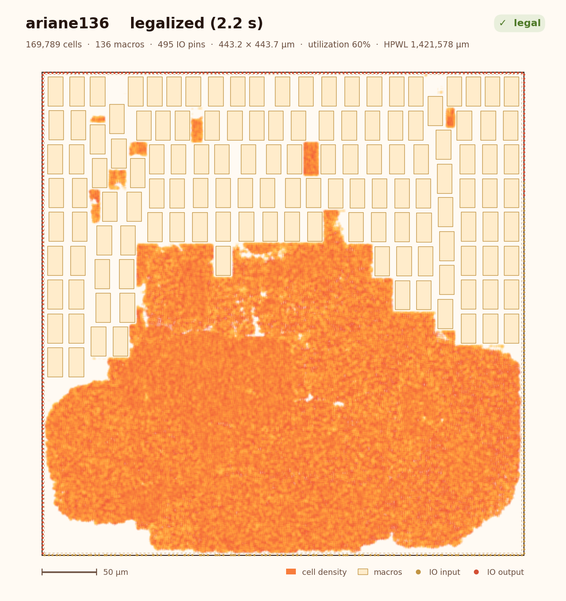
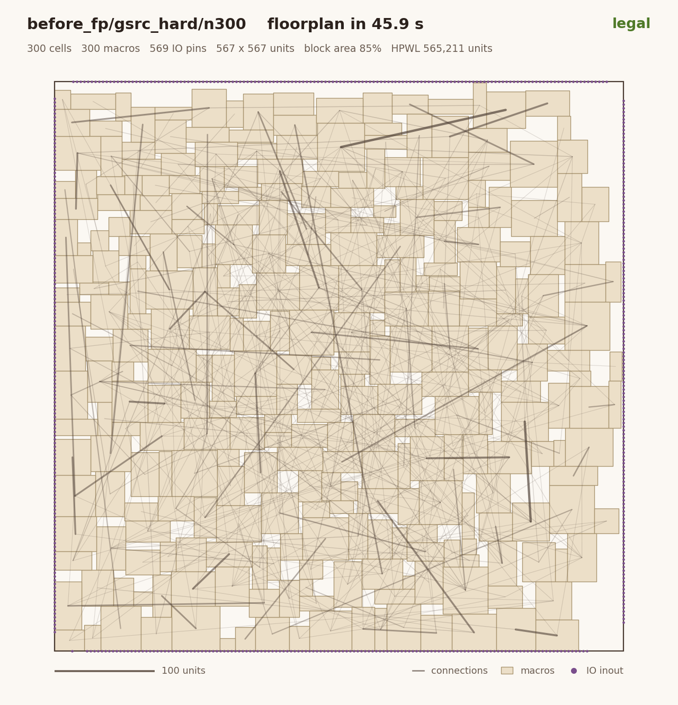

<div align="center">


將多樣的 P&R 基準測試濃縮成一個即插即用、跑在 GPU 上的 PyTorch 環境。<br>
以分鐘而非數天的時間，演進 VLSI 擺置、時序最佳化與繞線演算法。

[](https://github.com/RayChang987/Attar/blob/main/pyproject.toml)
[](https://pytorch.org)
[](https://pepy.tech/projects/attar)
[](https://github.com/RayChang987/Attar/blob/main/docs/features.md#evaluators)
[](https://github.com/RayChang987/Attar/tree/main/tests)
[](https://github.com/RayChang987/Attar/blob/main/LICENSE)

[English](README.md) &nbsp;·&nbsp; **繁體中文** &nbsp;·&nbsp; [简体中文](README.zh-CN.md)

[快速開始](#快速開始) &nbsp;·&nbsp; [為什麼選 Attar](#為什麼選-attar) &nbsp;·&nbsp; [內容總覽](#內容總覽) &nbsp;·&nbsp;
[運作方式](#運作方式) &nbsp;·&nbsp; [圖庫](#圖庫)

</div>

## 快速開始

```bash
pip install attar
```

```python
import attar
d = attar.load('after_fp/orfs_asap7/aes', device='cuda')   # 從 zoo 載入，以張量形式放在 GPU 上
d.place()                                                   # 或用你自己的演算法設定 d.pos
print(attar.Evaluator(d).hpwl(), d.timing().wns)            # HPWL，以及與 OpenSTA 一致的 WNS
d.export('aes.def')                                         # 匯出回 OpenROAD、Innovus、ICC2 等
```

設計會在首次使用時從 [Attar zoo](https://huggingface.co/datasets/RayChang987/attar-zoo) 下載。GPU 上第一次執行時序分析會編譯 kernel（約兩分鐘，每台機器一次；Colab 則是每個 runtime 一次，除非 `TRITON_CACHE_DIR` 與 `TORCHINDUCTOR_CACHE_DIR` 指向會保留的資料夾）。沒有 GPU？所有功能也都能在 CPU 上執行，或在 Colab 試用以下範例：

| notebook | 內容 |
| --- | --- |
| [](https://colab.research.google.com/github/RayChang987/Attar/blob/main/examples/colab/timing_driven_colab.ipynb) | 十五行的時序驅動擺置，即下方示範：先為線長擺置 cva6、做時序分析、如 OpenROAD 依 slack 為 net 加權、再擺置一次 |
| [](https://colab.research.google.com/github/RayChang987/Attar/blob/main/examples/colab/latte_on_attar.ipynb) | **[DAC 2026]** LATTE 時序驅動 detailed placement，逐步拆解：錨定在 Attar timer 上的可微分 timer、獨立集、Adam 加 CAWP，以 Attar global routing 後的時序評估，在 ICCAD 2025 競賽設計上（英文） |
| [](https://colab.research.google.com/github/RayChang987/Attar/blob/main/examples/colab/p11_attar_superblue18.ipynb) | **[DAC 2026]** net–pin 混合加權時序驅動 global placement，逐步拆解：DATE 2025 的 pin 對加上由延遲模型推導的 net 權重，建在 Attar 的 timer 與 placer 上，在 superblue18（74.5 萬 cells）上跑（英文） |
| [](https://colab.research.google.com/github/RayChang987/Attar/blob/main/examples/colab/date25_attar_superblue18.ipynb) | **[DATE 2025]** pin 對加權時序驅動 global placement，逐步拆解，在 superblue18 上跑（英文） |

<div align="center">


<sub>15 行程式碼完成時序驅動擺置（<a href="examples/timing_driven.py">examples/timing_driven.py</a>）：
cva6 的 WNS 由 -195 ps 改善至 -75 ps，在 RTX 3080 Ti 上僅需 2.2 秒。</sub>
</div>

## 為什麼選 Attar

- **快。** 890 萬個 pin 的精確 HPWL 只要 3 ms；220 萬 cell 的設計擺置加合法化只要 49 秒。無論是你的程式碼或 AI agent 提出的點子，都能在數秒內驗證，不必等一整夜的 P&R。
- **統一環境。** 來自 24 個基準測試套件（ISPD 2005-2024、ICCAD 2015 與 2025、MCNC、GSRC、IBM-HB+、OpenROAD-flow-scripts）的 262 個設計，一個呼叫、一種格式即可載入，支援 LEF/DEF、Bookshelf 或 YAL。演算法就是「張量到位置」的函式：不需資料庫 API，也不用 TCL。
- **忠實。** 在同一份擺置上對比 OpenROAD 與 OpenSTA：HPWL 誤差 0.00002% 以內、時序（WNS）0.34% 以內、功耗 0.06% 以內、全域繞線線長 3.6% 以內。

## 內容總覽

<p align="center"></p>

所有引擎與評估器，以及它們對比 OpenROAD 與 OpenSTA 的精確度：
[docs/features.md](https://github.com/RayChang987/Attar/blob/main/docs/features.md).

## 運作方式

<p align="center"></p>

Attar 如同量產流程，在電源網格（power grid）處將實體設計一分為二：

- **`before_fp`**：給定 netlist，決定晶片面積、IO pin 與巨集（`d.floorplan()`）。
- **`after_fp`**：給定已固定的 floorplan 與 PDN，擺置 cell，接著調整尺寸、插入緩衝器、繞線並做時序分析（`d.place()`）。

每個設計都會說明它已有哪些資訊及其來源，每個引擎也會說明它需要哪些資訊：

```text
>>> d.status()
  ✅ netlist           def             12268 nets, 42885 pins
  ✅ cell_geometry     lef             12420 cells (12009 movable, 0 macros), 56 masters
  ✅ pdn               def             1815 wire and 4785 via shapes on M1, M2, M3
  ...
  ❌ placement         12009 movable cells unplaced
  -> 只缺擺置：擺置設計後執行 d.export("out.def")
```

文件：[概念](https://github.com/RayChang987/Attar/blob/main/docs/concepts.md) ·
[引擎與評估器](https://github.com/RayChang987/Attar/blob/main/docs/features.md) ·
[基準測試](https://github.com/RayChang987/Attar/blob/main/docs/benchmarks.md) ·
[API](https://github.com/RayChang987/Attar/blob/main/docs/api.md) ·
[validation](https://github.com/RayChang987/Attar/tree/main/docs/validation)

## 圖庫

<table>
<tr>
<td colspan="2"></td>
</tr>
<tr>
<td colspan="2"><sub><b>Floorplan</b> GSRC n100：B*-tree packing 在 5.1 秒內將 100 個區塊全部放入核心。</sub></td>
</tr>
<tr>
<td width="50%"></td>
<td width="50%"></td>
</tr>
<tr>
<td><sub><b>繞線壅塞</b> cva6，2.4 秒完成擺置。</sub></td>
<td><sub><b>Pin access</b> ariane136：訊號 pin 位於 PDN via 上的 cell。</sub></td>
</tr>
<tr>
<td></td>
<td></td>
</tr>
<tr>
<td><sub><b>合法擺置</b> ariane136，含 rail 與 PDN，2.4 秒。</sub></td>
<td><sub><b>Floorplan</b> GSRC n300：300 個區塊、569 個 IO pin，43 秒完成 packing。</sub></td>
</tr>
</table>

## 致謝

Attar 的擺置器遵循 ePlace、DREAMPlace 與 Xplace；檢查則遵循 OpenROAD。它在 ASAP7 與 Nangate45 上對 [OpenROAD-flow-scripts](https://github.com/The-OpenROAD-Project/OpenROAD-flow-scripts) 做過驗證。基準測試來自 ISPD、ICCAD、GSRC 競賽、MCNC 與 ORFS。

## 授權

<div align="center">
<a href="LICENSE"></a>
<br><br>
<sub>Copyright &copy; 2026 RayChang987 &nbsp;·&nbsp; 可自由使用、修改與散布；詳見 <a href="LICENSE">LICENSE</a></sub>
<br><br>

</div>
