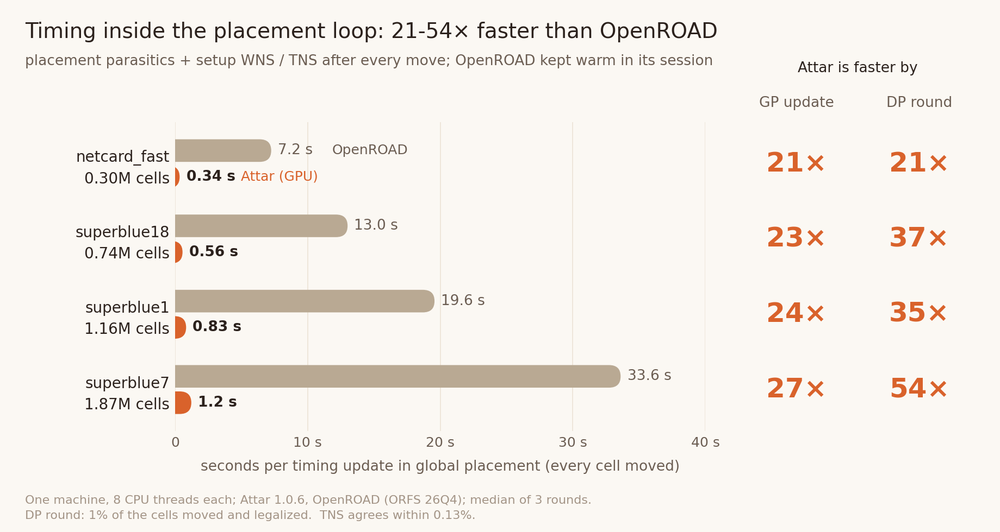

# Speed against OpenROAD kept warm

Time per timing update inside a placement loop: Attar against OpenROAD with the design already loaded in the same
session, so neither side reads files. The comparison against a cold OpenSTA run (reads included) is in
[timing_routing.md](timing_routing.md).

## Setup

- One machine: RTX 4090, 32 cores. Attar 1.0.6 (torch 2.5.1, 8 CPU threads); OpenROAD from the ORFS image
  `26Q4-368-g9ca2a9e76`, `-threads 8`. Each measurement runs alone.
- Designs: netcard_fast (ICCAD 2025, ASAP7, ideal clocks); superblue18, superblue1, superblue7 (ICCAD 2015, Late
  library, contest wire RC). Start: the zoo's `after_fp` placement.
- Rounds, generated once by Attar and replayed on both sides:
  - **GP update**: every movable cell moves by up to 1 um in x and y, unlegalized.
  - **DP round**: 1% of the movable cells move by up to 1 um and are legalized (`naive.legalize(cells=mask)`);
    rounds are chained.
- Per round, OpenROAD gets the changed instances through odb (`setOrient`, `setLocation`) and runs
  `estimate_parasitics -placement`, `sta::worst_slack -max` and `sta::total_negative_slack -max`. Attar gets `d.pos`
  and runs `d.timing().summary()`. Handing over positions is not timed. Each process evaluates the start placement
  once, then times three rounds; the table gives the median.

## Results

| design | cells | GP update, OpenROAD | GP update, Attar GPU | speedup | DP round, OpenROAD | DP round, Attar GPU | speedup |
| --- | ---: | ---: | ---: | ---: | ---: | ---: | ---: |
| netcard_fast | 298,384 | 7.25 s | 0.343 s | 21x | 5.19 s | 0.242 s | 21x |
| superblue18 | 744,947 | 13.0 s | 0.561 s | 23x | 11.5 s | 0.313 s | 37x |
| superblue1 | 1,159,346 | 19.6 s | 0.831 s | 24x | 16.2 s | 0.469 s | 35x |
| superblue7 | 1,865,884 | 33.6 s | 1.22 s | 27x | 30.6 s | 0.566 s | 54x |

On the CPU (8 threads) Attar takes 2.4-8.7 s per update, 2-4x faster than OpenROAD. A DP round gains more because
Attar recomputes the parasitics of the moved nets only; `estimate_parasitics -placement` redoes every net.

Agreement: TNS within 0.13% on superblue, worst slack within 0.002 ps on netcard_fast. OpenROAD's third round in the
session matches a cold read of the same placement bit for bit.

## Notes

- Moving instances with `read_def -incremental` instead of odb makes OpenROAD's timing differ from a cold read of the
  same DEF (superblue18: TNS -2620824 vs -2623989), though the odb positions are the same. The numbers above use odb.
- Global routing (netcard_fast, before CTS, one design, not in the figure): FastRoute takes 1100-1460 s per call and
  1620-2500 s incremental; Attar on the GPU 3.4 s (incremental 1.2 s). Most of FastRoute's time goes to the
  84,026-pin ideal clock net; with `-skip_large_fanout_nets 1000` it takes 189 s.
- On small designs (2k-22k cells, ICCAD 2025 IWLS) the gap is 1-8x, and OpenROAD's incremental global routing beats
  Attar's on the smallest.
